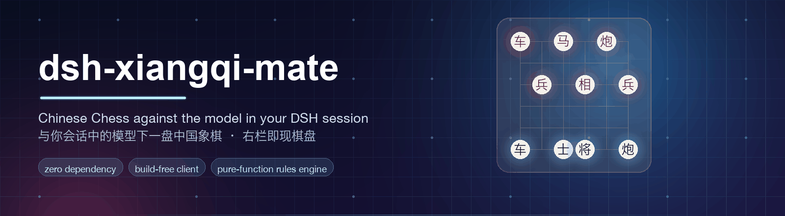
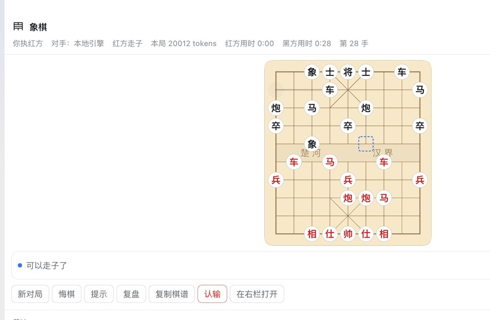

# dsh-xiangqi-mate · 象棋对弈助手

> 一款运行在 [DeepSeek Harness](https://harness.deepseek.com) 中的中国象棋人机对弈插件。
> 打开面板即现棋盘：**你执红先行，当前会话所配置的 AI 模型执黑应招**，画面精美简约，落子之间见智慧。

[English](README.md) · **中文**

---

## 目录

- [它是什么](#它是什么)
- [界面截图](#界面截图)
- [安装](#安装)
- [怎么用](#怎么用)
- [工具与命令](#工具与命令)
- [配置](#配置)
- [棋规引擎（可独立复用）](#棋规引擎可独立复用)
- [让模型对手回得更快](#让模型对手回得更快)
- [开发与测试](#开发与测试)
- [设计文档](#设计文档)
- [隐私与安全](#隐私与安全)
- [许可证](#许可证)

---

## 它是什么

`dsh-xiangqi-mate` 不是一个「象棋工具集合」，而是一局**能下完的棋**：

| | 说明 |
| --- | --- |
| **棋盘在右栏** | 会话右栏的一个 tab，与对话并排，不打断你正在做的事 |
| **对手是模型** | 默认由当前会话所配置的模型执黑；插件自己发请求，**不会把你的对话搅进棋局历史** |
| **模型不灵时有人兜底** | 超时、限流、输出非法着法 → 内置本地引擎（alpha-beta）代走，并如实告诉你发生了什么 |
| **中文记谱是双向的** | 棋盘显示「炮二平五」，你也可以直接对它说「炮二平五」——不必记坐标 |
| **零依赖、免构建** | 宿主半只用 Node 内置模块；浏览器半是手写的单文件 bundle。安装不执行任何脚本 |
| **引擎可单独拿走** | `lib/engine/**` 是纯函数模块，不认识 DSH，可以直接用在别的项目里 |
| **跟随你的语言** | 界面文案全部走字典，跟随 DSH 的语言设置（中文 / English）——切换应用语言，面板随之切换，无需重启 |

### 与社区同类的区别

社区已有三个中国象棋 DSH 插件，恰好覆盖三种架构：

| 插件 | 对手怎么走 |
| --- | --- |
| `9527ccccccc/dsh-xiangqi` | 唤醒当前会话，让模型通过工具走子 |
| `TryDing-T/dsh-Plugin--ChineseChess` | 直连 `ctx.llm`（与本插件同路线），但模型失败时停在原地 |
| `ovdoesw/dsh-xiangqi` | 纯本地引擎，模型只做点评（不用会话模型） |

本插件取**直连模型 + 本地引擎兜底**：比第一种省上下文（一步棋不会在对话里留下一整轮记录），比第三种有真对手，比第二种不会因为一次超时就把棋局卡住。

---

## 界面截图



*棋盘就在右栏、与对话并排。下方依次是状态条、工具条（新对局 · 悔棋 · 提示 · 复盘 · 复制棋谱 ·
认输 · 在右栏打开）以及中文记谱的着法列表。*


*顶栏写清对手是谁、轮到哪一方、本局累计 token 用量、双方用时与手数——花费与进度都不必靠猜
（FR23/FR24）。*

---

## 安装

### 方式一：在会话里让 Harness 安装（推荐）

```
plugin_manager { action: "install_bundle", target: "github:lpeixin/dsh-xiangqi-mate" }
```

或把仓库克隆到本地后，用绝对路径安装：

```
plugin_manager { action: "install_bundle", target: "/path/to/dsh-xiangqi-mate" }
```

> 只认 `application: "applied"`。若是 `restart-required`，重启 DSH 才会生效。

### 方式二：手动装进 profile

本仓库是一个可安装的 bundle（`package.json` 的 `dsh.bundle.patch` 指向 `cordis.patch.yml`）。在 profile 的 `package.json` 里把它加进 `dsh.profile.bundles` 与 `dependencies`，然后安装依赖即可。

### 临时关闭（不卸载）

在 profile 的 `cordis.patch.yml` 里按 id 覆盖：

```yaml
- id: xiangqi
  disabled: true
```

---

## 怎么用

### 打开棋盘

三条入口，任选：

1. **右栏「+」→「开始」页 → 点「象棋」** —— 面板 tab 条上的加号里就有。注意：**面板需要你自己打开一次**；静态插件没有宿主→客户端的推送通道，无法在你调工具时自动弹出面板；
2. **直接在会话里说**：「来一盘象棋」——模型会调用 `xiangqi_new` 开局，棋盘随之出现；
3. **左栏的象棋图标** —— 打开主区域的大棋盘（适合专心下棋）。

### 下棋

| 操作 | 做法 |
| --- | --- |
| 走子 | 点自己的棋子 → 高亮可走点 → 点目标落子；也可以拖拽 |
| 看走法 | 棋盘右侧是双方的中文记谱，点任意一手可跳到那个局面复盘 |
| 悔棋 | 工具条「悔棋」，退回你自己上一手之前 |
| 提示 | 工具条「提示」，本地引擎给 3 条候选（**不消耗模型额度**） |
| 认输 / 新对局 | 工具条按钮，都会二次确认 |
| 键盘走子 | Tab 进入棋盘 → 方向键移动光标 → Enter 选中/落子 → Esc 取消 |

### 当模型不灵时

状态条会明确告诉你发生了什么，例如：

- `AI 思考中…` —— 已发出请求，正在等模型；
- `模型超时，已由本地引擎代走` —— 等满 `opponent.timeoutMs`（默认 60 秒）仍未返回，棋局继续，不卡住；
- `模型返回的着法不合法，已重试 2 次后由本地引擎代走`；
- `本局模型额度已用完，后续由本地引擎应招`。

你也可以随时点「由本地引擎代走」自己催一下。

---

## 工具与命令

模型可以调用这些工具（你也能在对话里直接要求）：

| 工具 | 作用 |
| --- | --- |
| `xiangqi_new` | 开新局或重开 |
| `xiangqi_board` | 查看当前局面：ASCII 棋盘、轮到谁、状态、中文记谱、可走着法 |
| `xiangqi_move` | 走一步。`move` 接受 ICCS（`h2e2`）、中文记谱（`炮二平五`）或 `{from,to}` |
| `xiangqi_undo` | 悔棋 |
| `xiangqi_hint` | 本地引擎给候选着法与评估摘要（不消耗模型额度） |
| `xiangqi_review` | 复盘：棋谱、关键转折、评估曲线 |

会话命令：

```
/xiangqi new | state | move 炮二平五 | undo | hint | resign | review
```

> 「认输」这类需要你本人确认的动作**只能由你触发**，模型不能替你决定。

---

## 配置

改 profile 的 `cordis.patch.yml`（**注意：patch 覆盖 `config` 是整体替换，不是深合并——要保留的键必须重述**）：

```yaml
- id: xiangqi
  config:
    opponent:
      mode: model          # model | local
      timeoutMs: 60000
      maxRetries: 2
      maxTokensPerMove: 256
      maxTokensPerGame: 20000
    local:
      depth: 4
      timeMs: 300
    rules:
      fiftyMovePlies: 120
      perpetualCheckLoses: true
    ui:
      showCoordinates: true
      showEval: false
      animation: true
      clock: off           # off | perMove | total
```

| 键 | 默认 | 说明 |
| --- | --- | --- |
| `opponent.mode` | `model` | `local` 则完全用本地引擎，不产生任何模型请求 |
| `opponent.provider` / `model` | 跟随会话 | 显式指定对手模型；不填则读当前会话所用的模型 |
| `opponent.timeoutMs` | `60000` | 超时即由本地引擎代走 |
| `opponent.maxTokensPerMove` / `PerGame` | `256` / `20000` | 双限；超限自动停用模型 |
| `local.depth` / `timeMs` | `4` / `300` | 本地引擎的搜索深度与时间双限 |
| `rules.fiftyMovePlies` | `120` | 自然限着（半回合数）无吃子判和 |
| `ui.*` | — | 坐标、评估条、动画、计时器 |

> **关于配置可发现性**：本插件用一个**手写、零依赖**的 StandardSchemaV1 声明配置，因此这些键在 Loader 行激活时会被**照常校验并补默认值**，但 schema **不会**被投影进 DSH 的配置工具链（宿主报告为 `unsupported`，不会列出字段）。请照上表在 profile 补丁里手写这些键——上表就是参考。（同类第三方插件则是完全不声明配置。）

---

## 棋规引擎（可独立复用）

`lib/engine/**` 是**纯函数、零依赖**的中国象棋规则引擎，不 import 任何 DSH 包、任何第三方包、任何 Node 内置模块——因此它既能跑在 Node 里，也能被直接内联进浏览器。

```js
import {
  initialPosition, generateMoves, applyMove, isLegalMove,
  positionFromFen, positionToFen, formatChinese, parseAnyMove,
  describePosition, evaluate, searchBestMove, gameStatus,
} from 'dsh-xiangqi-mate/lib/engine/index.js'
```

已实现：车/马（蹩马腿）/炮（炮架）/相象（塞象眼、不过河）/仕士/帅将（九宫、将帅照面）/兵卒（过河横走）的完整走法与合法性；将死、**困毙判负**、三次重复、自然限着；ICCS 与中文记谱双向（含 `前/后/中` 消歧）；局面描述与可解释的评估；迭代加深 alpha-beta 搜索。

正确性由公开的 perft 基准守住（见 [docs/DESIGN.md](docs/DESIGN.md) §5.8）：

```bash
node scripts/perft.mjs --depth 4
```

---

## 让模型对手回得更快

插件是让**你当前会话正在用的模型**来走子的，并且沿用该会话的推理档位。如果模型是高推理档，
一步棋可能超过默认预算：此时插件会等满 `opponent.timeoutMs`（默认 **60 秒**），然后改由
**本地引擎**代走——面板会明确写出来（*「模型超时，已由本地引擎代走」*）。这条降级路径有测试
覆盖，不是故障；但如果你确实想让模型来下，有两个旋钮：

```yaml
# 写进 profile 的 cordis.patch.yml
- id: xiangqi
  config:
    opponent:
      reasoningEffort: low     # 选一步棋不需要高推理档；提速与省额度都很明显
      timeoutMs: 120000        # 给慢模型更多时间（客户端默认最多轮询 75 秒）
```

- `reasoningEffort` 可不填，表示跟随会话当前档位。若模型不接受该档位，插件会**不带档位**重试一次，所以填它是安全的。
- `timeoutMs` 是**宿主侧**的预算；浏览器半只在宿主报告 `ai-thinking` 时继续轮询，到自己的上限（75 秒）才停。
  上限刻意设得**更大**——"该等多久"的真相来源只有一个，就是宿主。
- profile 若开了 `patchReload: live`，改配置**无需重启** DSH 即可生效。

## 开发与测试

```bash
node --test                                   # 全部单测
node --test --experimental-test-coverage      # 覆盖率
node scripts/check-boundaries.mjs             # 静态边界门禁（零依赖/免构建/无 default export 等）
node scripts/build-client.mjs --check         # 校验 lib/client.js 与生成源一致
node scripts/perft.mjs --depth 3              # 引擎基准
node scripts/xiangqi-cli.mjs play --moves 60  # 引擎自战冒烟，打印中文棋谱
```

工程约束（改代码前请先读 [docs/DESIGN.md](docs/DESIGN.md) §9.3）：

1. **零外部依赖**：宿主半只允许 `node:*` 内置模块；
2. **`lib/client.js` 是生成物**：改 `lib/engine/**` 或 `lib/ui/**` 后必须跑 `npm run build:client` 并提交产物；
3. **无 `export default`**：会丢掉 `inject`；
4. **不要写自定义会话事件**：会让会话重启后无法恢复；
5. **不要产生游离异步**：未捕获的 rejection 会让整个 DSH 退出。

---

## 设计文档

| 文档 | 内容 |
| --- | --- |
| [docs/DESIGN.md](docs/DESIGN.md) | 完整设计文档：需求规格、技术选型、引擎规格、宿主半与浏览器半设计、目录结构、测试与验收、里程碑、风险，以及 **21 条 DSH API 证据索引** |
| [docs/ENGINE.md](docs/ENGINE.md) | 把棋规引擎当独立库用：坐标与两种记谱方言、完整 API 面、复用方式 |
| [docs/TOOLS.md](docs/TOOLS.md) | 对外契约：工具、会话命令、RPC 端点、跨半通道、配置与技能 |
| [docs/ARCHITECTURE.md](docs/ARCHITECTURE.md) | 代码在哪、为什么这样分：宿主半、浏览器半、免构建打包流程与扩展点 |
| [docs/VERIFICATION.md](docs/VERIFICATION.md) | 验证记录：实测了什么、怎么测的、抓到了哪些缺陷（含两个上游/平台缺陷） |
| [docs/research/ai-move-paths.md](docs/research/ai-move-paths.md) | 「AI 怎么走棋」的调研报告（含社区三个同类插件的架构对比） |
| [CHANGELOG.md](CHANGELOG.md) | 变更历史 |

---

## 隐私与安全

- **对局数据留在本机**：棋谱按会话写到会话工作目录下的 `.xiangqi-mate/<sessionId>.json`（可在配置里关闭），不上传任何地方。
- **只会调用你已配置的模型**：插件使用当前会话的模型路由，不自行申请凭据、不引入新的外部服务。
- **花费可见**：面板显示本局累计 token 用量；可用 `maxTokensPerGame` 硬性封顶。
- **只读 RPC 有边界**：浏览器半到宿主半的通道只接受本会话的棋局读写，且只在本机浏览器内可用。
- 漏洞报告流程见 [SECURITY.md](SECURITY.md)。

---

## 许可证

MIT © 2026 Peixin
