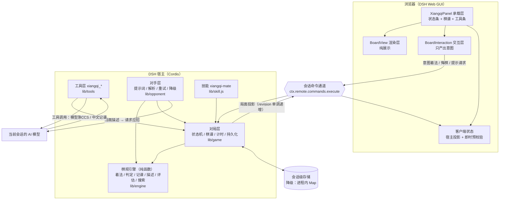

# dsh-xiangqi-mate 设计文档

| 字段 | 内容 |
| --- | --- |
| 文档版本 | v0.2（补齐第一、二章之后的全部章节，待评审） |
| 目标版本 | v0.1.0 |
| 状态 | **待评审** —— 评审通过后进入实现（§10 里程碑 M1） |
| 基线环境 | DeepSeek Harness `0.2.0-rc.2`（desktop profile，`hostProtocolVersion: 4`） |
| 读者 | 插件作者（实现方）、DSH 集成评审者、想要复用棋规引擎的第三方开发者 |

本文档承接产品方给出的《一、项目命名》《二、项目概述》两章原文，并在其之后补齐**需求规格、技术选型与总体架构、棋规引擎规格、宿主半设计、浏览器半设计、目录结构、测试与验收、里程碑、风险**各章。凡是与 DSH 宿主 API 相关的结论，都在 §12.3 给出**源码证据索引**（`包名/文件:行`），便于实现时逐条核对。

---

## 0. 阅读指引与术语

### 0.1 文档约定

- **MUST / SHOULD / MAY**：分别表示必须、应当、可选。
- **P0 / P1 / P2**：需求优先级。P0 = v0.1.0 必须交付；P1 = v0.1.0 力争交付；P2 = 明确排到后续版本。
- 所有「函数签名」均为 ESM 命名导出，`.js` 后缀显式书写。
- 文中出现 `路径:行` 形式的引用指向本机解包后的 DSH 源码（见 §12.3 的路径前缀说明）。

### 0.2 术语表

| 术语 | 含义 |
| --- | --- |
| DSH | DeepSeek Harness，本文档的宿主应用 |
| 插件包 / bundle | 一个 npm 包，通过 `dsh.bundle.patch` 或 `dsh.client` 声明自己如何被 profile 装载 |
| 宿主半（host half） | 插件在 Node 侧运行的代码，入口 `main`（`lib/index.js`） |
| 浏览器半（client half） | 插件在 Web GUI 内运行的代码，入口 `exports["./client"]`（`lib/client.js`） |
| Profile | DSH 的插件组合根，如 `~/.dsh/profiles/desktop`，由 `package.json` + `cordis.patch.yml` 定义 |
| Loader 行 | profile 补丁中的一个插件条目，形如 `- id: xiangqi` / `name: 'dsh-xiangqi-mate'` |
| Slot（插槽） | 客户端 UI 的扩展点，插件通过 `ctx.slots.register(...)` 把自己的 React 组件注册进某个具名座位 |
| 棋规引擎 | 本插件的纯函数核心：走子生成、合法性、胜负判定、记谱、局面描述 |
| ICCS | 中国象棋坐标记法，列 `a`–`i`（红方视角从左到右），行 `0`–`9`（红方底线为 0） |
| 中文记谱 | 「炮二平五」式的着法写法，红方用中文数字、黑方用阿拉伯数字，均从各自右手边数起 |

---

## 1. 项目命名

| 字段 | 内容 |
| --- | --- |
| npm 包名 | `dsh-xiangqi-mate` |
| 中文名 | 象棋对弈助手 |
| 英文名 | Xiangqi Mate — Human vs AI Chinese Chess for DeepSeek Harness |
| 中文描述 | 一款运行在 DeepSeek Harness 中的中国象棋人机对弈插件。启动即现棋盘，以 DSH 当前配置的 AI 模型为对手，画面精美简约，落子之间见智慧。 |
| 英文描述 | A human-vs-AI Chinese Chess (Xiangqi) plugin for DeepSeek Harness. Launch the plugin and a beautifully minimal board appears — play against whichever AI model is configured in your DSH session. |

**命名依据**：DSH 社区插件统一使用 `dsh-` 前缀；Loader 行 id 使用 kebab-case（本文档取 `xiangqi`）。`xiangqi-mate` 中 "mate" 取「棋友 / 对手」之意，兼顾中式语境与国际可读性。

**与仓库/包标识的一致性约束（MUST）**：

- `package.json` 的 `name` 必须是 `dsh-xiangqi-mate`；
- 插件入口导出的 `name` 必须是 `xiangqi`（与 `cordis.patch.yml` 的 Loader 行 `id` 一致）；
- 工具名前缀统一为 `xiangqi_`，命令名前缀统一为 `/xiangqi`；
- 客户端 locale 命名空间为 `xiangqi`，插槽 id 前缀为 `xiangqi.`。

---

## 2. 项目概述

### 2.1 产品定位

`dsh-xiangqi-mate` 是一个 DSH 插件。用户在 DSH 会话中启动后，会在 DSH 的右栏（会话右面板）或主区域中打开一个中国象棋棋盘。用户执红先行，AI（即当前 DSH 会话所使用的模型）执黑应招。对弈过程中，棋盘状态与 DSH 会话打通：棋盘上的走子会转化为模型可理解的局面描述，模型的应招通过工具调用落回棋盘。

### 2.2 核心理念

> 「棋在盘中，局在话中。」

用户不需要离开 DSH 会话，也不需要用文字描述棋局。点击棋盘即可走子，AI 通过 DSH 工具系统完成决策与应招。整个对局过程既是一盘棋，也是一段 DSH 会话历史。

### 2.3 目标用户

| 用户 | 诉求 | 对应设计特征 |
| --- | --- | --- |
| 想休闲一局的 DSH 用户 | 点开即下，不写提示词 | 面板自带「新对局」，红方点击即走子（FR1–FR4） |
| 想观察模型策略表现的开发者 | 看模型在博弈中的推理与失误 | 每步可选把模型的思考摘要写入会话；复盘模式（FR12） |
| 需要演示 DSH 工具调用与 UI 集成的布道者 | 一眼看懂「UI ↔ 工具 ↔ 模型」闭环 | 单页架构图 + 工具调用卡片内联棋盘（§6.2、§7.2） |
| 想复用棋规引擎的第三方开发者 | 零依赖、可单独安装 | 引擎为纯函数模块，`lib/engine/**` 无任何宿主 import（§5） |

### 2.4 与已有方案的区别

社区已存在 `dsh-xiangqi` 插件，其核心是「棋规引擎 + 会话工具」，棋盘在右栏，AI 通过 `xiangqi_move` 等工具走子。`dsh-xiangqi-mate` 的差异化在于：

1. **更强的视觉设计**：简约美学，棋盘渲染层与交互层解耦，支持动画与主题切换；
2. **更完整的对弈体验**：内置悔棋、提示、复盘模式、计时器；
3. **对 AI 更友好的局面表示**：不仅提供坐标，还提供中文记谱、局面评估摘要；
4. **可独立运行**：棋规引擎为纯函数模块，零依赖，可单独用于其他项目。

**补充第 5 条差异（本文档新增，理由见 §4.4）**：

5. **对手可降级**：默认由当前 DSH 会话的模型执黑；当模型不可用、超时或返回非法着法时，自动降级到内置的本土搜索引擎（零依赖 alpha-beta），对局不中断。

---

## 3. 需求规格

### 3.1 功能需求（可核对）

| 编号 | 需求 | 优先级 | 验收方式 |
| --- | --- | --- | --- |
| FR1 | 在 DSH 中打开象棋面板，立即渲染标准初始局面棋盘 | P0 | 面板截图 + §7.4 交互用例 |
| FR2 | 用户在棋盘上点击/拖拽完成合法走子，红方先行 | P0 | 单测（引擎）+ UI 手测 |
| FR3 | 非法走子被拒绝并给出原因（蹩马腿 / 塞象眼 / 炮无架 / 送将 / 照面 / 走法不符） | P0 | 引擎单测覆盖每条规则各 ≥2 例 |
| FR4 | 平台侧棋盘状态与宿主侧对局状态双向同步，刷新页面后局面不丢 | P0 | 刷新后局面一致 |
| FR5 | 模型（当前会话模型）执黑应招，通过工具调用落回棋盘 | P0 | 会话内可见 `xiangqi_move` 调用 |
| FR6 | 提供工具：`xiangqi_board` / `xiangqi_move` / `xiangqi_new` / `xiangqi_undo` / `xiangqi_hint` | P0 | 工具表 §6.2 逐条 |
| FR7 | 中文记谱：棋盘侧栏展示双方着法序列（中文记谱） | P0 | 记谱测试矩阵 §5.5 |
| FR8 | 接受中文记谱输入（模型可直接说「炮二平五」，无需坐标） | P0 | `parseChinese` 测试 |
| FR9 | 胜负判定：将死 / 困毙（判负）/ 长将 / 自然限着 / 三次重复 | P0 | 引擎单测 |
| FR10 | 悔棋（退回到自己上一手之前）与重开 | P1 | UI 手测 |
| FR11 | 提示：给出候选着法与评估摘要（不消耗模型额度） | P1 | 引擎单测 + UI |
| FR12 | 复盘模式：逐步回放、跳转、显示每步评估变化 | P1 | UI 手测 |
| FR13 | 计时器：双方用时 + 每步用时（可关闭） | P1 | UI 手测 |
| FR14 | 主题自适应：亮/暗主题下棋盘配色跟随 DSH 主题令牌 | P0 | 亮/暗截图对比 |
| FR15 | 中英文界面（跟随 DSH locale） | P1 | locale 切换手测 |
| FR16 | 对局记录持久化，按会话隔离，可导出棋谱（中文记谱 + FEN 序列） | P1 | 重启后仍可复盘 |
| FR17 | 模型不可用/超时/返回非法着法时，降级到本地引擎并提示用户 | P1 | 注入失败场景手测 |
| FR18 | 技能（Skill）：向模型说明如何与棋盘协作（对局礼仪、工具用法、局面描述约定） | P1 | 技能注册成功 + 会话内生效 |
| FR19 | 会话命令 `/xiangqi`：客户端调用宿主半的**唯一受支持通道**（`new` / `state` / `move` / `undo` / `hint` / `resign` / `review`） | **P0** | 见 §7.5；命令单测 + UI 手测 |
| FR20 | 引擎可独立复用：`lib/engine/**` 不 import 任何 DSH 或 Node 之外的东西 | P0 | CI 静态检查（§9.3） |
| FR21 | 无障碍：棋盘可用键盘走子（Tab 选中棋子 → 方向键选目标 → Enter 确认），着法区可被读屏播报 | P2 | 手测 + 键盘走子录屏 |
| FR22 | 导出/复制棋谱到剪贴板 | P2 | UI 手测 |
| FR23 | 本局模型开销可见：面板显示对手模型名与本局累计 token 用量；可随时切换到本地引擎继续 | P0 | UI 手测 + `usage` 累加正确 |
| FR24 | 对手模型选择：默认取当前会话的默认模型配置，允许通过插件 Config 覆盖 provider/model/推理档位 | P1 | Config 生效 + 面板显示正确 |

### 3.2 非功能需求

| 编号 | 需求 | 指标 |
| --- | --- | --- |
| NFR1 | 零运行时依赖 | `package.json` 无 `dependencies`；宿主半只用 `node:*` 内置模块 |
| NFR2 | 无构建步骤 | `lib/**` 即为可直接加载的产物；安装时不执行任何脚本（`hasInstallScript` 为假） |
| NFR3 | 冷启动开销 | 引擎加载 + 初始局面生成 < 5 ms；一次 `generateMoves`（中局约 40 个着法）< 2 ms |
| NFR4 | 提示延迟 | 本地 alpha-beta 深度 4 在 < 300 ms 内返回（Apple Silicon 基线） |
| NFR5 | 面板不阻塞会话 | 打开棋盘不触发模型调用；只有 AI 轮次才产生模型交互 |
| NFR6 | 失败不致命 | 任何棋盘/引擎异常都不得让会话进入不可用状态；错误就地降级并在面板内提示 |
| NFR7 | 可测试 | `node --test` 全绿；引擎行覆盖率 ≥ 90%、分支 ≥ 85% |
| NFR8 | 安装体积 | tarball ≤ 300 KB（不含 README 图片时 ≤ 250 KB） |
| NFR9 | 安装方式 | 支持 `file:` 本地路径与 GitHub 两种安装方式（与 `dsh-project-compass` / `dsh-qualityforge` 一致） |

### 3.3 明确不做（Non-goals）

以下内容**明确不在 v0.1.0 范围**，避免范围蔓延：

1. **不实现联机对战 / 房间 / 观战**；
2. **不做专业级棋力**：本地引擎目标是「合法、不犯低级错误、300 ms 内出手」，不是引擎锦标赛棋力；不接入 Pikafish/ElephantEye 等外部引擎；
3. **不实现完整亚洲规则的长将/长捉裁决表**：v0.1.0 采用「长将判负 + 三次重复判和」的简化裁决，并在文档与 UI 中标注「休闲规则」；
4. **不做棋谱数据库 / 开局库**；
5. **不做多语言除中英之外的语种**（结构上预留）；
6. **不在 v0.1.0 支持移动端窄屏专用布局**（面板宽度自适应，但不做专门的手势设计）。

---

## 4. 技术选型与总体架构

### 4.1 双半插件模型（DSH 原生形态）

DSH 的插件包可以同时拥有 **宿主半（Node）** 与 **浏览器半（Web GUI）**，两者是**同一个 npm 包**的两张脸，由 `package.json` 分别声明：

```jsonc
{
  "name": "dsh-xiangqi-mate",
  "main": "lib/index.js",                    // 宿主半入口（Cordis 插件：name/inject/apply）
  "exports": {
    ".":        "./lib/index.js",
    "./client": "./lib/client.js"            // 浏览器半入口（客户端 Cordis 插件）
  },
  "dsh": {
    "bundle": { "patch": "./cordis.patch.yml" },                        // 宿主半如何装进 profile
    "client": { "platform": "web", "inject": [ /* 依赖的客户端包 */ ] }   // 浏览器半如何被装载
  }
}
```

两侧的分工：

| | 宿主半 | 浏览器半 |
| --- | --- | --- |
| 运行环境 | DSH 的 Node 进程（Cordis 容器） | Web GUI 的浏览器页面 |
| 提供 | 工具（`xiangqi_*`）、对局状态、持久化、与模型交互、棋规引擎 | 棋盘渲染与交互、棋谱、计时、主题 |
| 装载方式 | profile 的 `cordis.patch.yml` 插入 Loader 行（id = `xiangqi`） | 宿主的 client-modules 把 `lib/client.js` 作为 bundle 经 `/plugins` 提供给页面，页面懒加载 |
| 通信 | — | 只能通过**宿主注册的会话命令**（客户端 `ctx.remote.commands.execute`）按需往返；宿主**没有**向客户端推送的通道，**也不能直接读 Node 侧内存**（§7.5） |

**为什么必须是双半**：棋盘是浏览器 UI（不可能由工具渲染），而棋规引擎、对局状态与模型交互需要宿主侧的会话与工具系统。社区同类带 UI 的插件都采用这一形态。

**设计要点**：浏览器半**不保存权威状态**——它每次渲染所用的局面都来自宿主半（§7.5）。这样刷新页面、切换会话、多窗口打开都不会出现「两个棋盘各说各话」。

### 4.2 总体架构



**分层依赖方向**（上层可依赖下层，反之禁止）：

```
tools / opponent / client   →   game   →   engine   →   （无依赖）
```

`engine → 无依赖` 是 FR20 与「零依赖」承诺的技术底座；任何一层反向依赖都会让引擎既不能独立复用，也不能被浏览器半内联复用。

### 4.3 承载位置选型

**结论：承载在「会话右栏的一个新 tab 类型」**，而不是主区域面板。

DSH 的右栏提供了**公开的 tab 类型注册表**，官方包与第三方包走同一条路径（证据见 §12.3-T4）：

```js
// ① 声明一种 tab 类型（静态声明，无运行时钩子），并顺带在右栏「开始」页登记一个入口
ctx.effect(() => ctx.sidebarRightTabs.register({
  id: 'dsh-xiangqi-mate',        // 该类型在 tab 系统中的唯一身份；扩展类型同名可覆盖内置类型
  kind: 'xiangqi',               // 页面型：不写 patterns，按 kind 打开
  title: () => t('panel.title'),
  guide: [{                      // 用户从右栏「+ → 开始」页进入本插件的入口卡片
    id: 'board', order: 10, commandId: 'xiangqi.open',
    title: () => t('guide.title'), description: () => t('guide.description'),
  }],
}), 'xiangqi: sidebar type')

// ② 注册该类型的正文与标题（key = 上面的 id）
ctx.slots.inject('sidebar.right.pane.tab',       () => ctx.slots.register({ name: 'sidebar.right.pane.tab',       key: 'dsh-xiangqi-mate', locale: NS }, XiangqiPanel))
ctx.slots.inject('sidebar.right.pane.tab.title', () => ctx.slots.register({ name: 'sidebar.right.pane.tab.title', key: 'dsh-xiangqi-mate' }, XiangqiTitle))

// ③ 打开（会自动展开右栏）
ctx.sidebarRight.openTab('xiangqi')
```

**打开这个面板的三条用户路径**（缺了入口用户就找不到棋盘，必须都做）：

| 路径 | 机制 | 优先级 |
| --- | --- | --- |
| 右栏「+」→「开始」页 → 点「象棋」胶囊 | 上面注册的 `guide` 条目，胶囊点击即 `tab.actions.openTab('xiangqi', { replaceTab: true })`；**这是唯一"零代码"入口，必须提供** | P0 |
| 会话内首次调用工具后自动打开 | 宿主半在 `xiangqi_new`/`xiangqi_move` 里通知客户端 `ctx.sidebarRight.openTab('xiangqi')`（见 §7.5 的轮询/命令通道） | P0 |
| 快捷键 / 侧栏动作按钮 | `ctx.sidebarRight.openTabFromTarget('xiangqi', target)`（官方 files/terminal 的用法）或面板内按钮直接 `ctx.sidebarRight.openTab('xiangqi')` | P2 |

**四条候选路径的对比与取舍**：

| 候选 | 提供的 API | 评价 |
| --- | --- | --- |
| **会话右栏 tab（v0.1.0 选定）** | `ctx.sidebarRightTabs.register`（两阶段：类型声明 + `sidebar.right.pane.tab` 正文，key = 类型 `id`）+ `ctx.sidebarRight.openTab(kind)` | 右栏是**每会话一个停靠面**，且正文组件的 scope 是 **session**，**天然拿到 `sessionId` → 直接满足 FR16 的「按会话隔离」**；`openTab` 会自动展开面板；支持停靠/浮动/分屏（最多两个水平 pane）；与「一局棋即一段会话、不打断对话」的产品理念一致 |
| 主区域面板（备选，**P1 可增补**） | `main`（keyed）注册一个 key + 左栏 `sidebar.panellist` 注册**同名字符串** `id`（点击即 `ctx.layout.selectPanel(id)`） | 一次注册同时得到「左栏图标 + 主区域棋盘」，无会话依赖，**但 scope 是 root，组件拿不到 `sessionId`**，要做 FR16 得自己用 `useSessions` 反查当前会话；且会把对话从主区域挤走，与"不离开会话"的理念相悖 |
| 对话内嵌卡片 | `conversation.chat.node` / `conversation.chat.turnTail` / `tool.call.toolview`（keyed by 工具名） | 不适合承载需要持续交互的棋盘（会被消息流滚走）；**保留用于「工具调用卡片里显示一个小棋盘」**（P1 增强，见 §7.2） |
| 浮层 | `shell.overlay` | 无锚定、无布局记忆；排除 |

> **易错点（务必写进实现注意事项）**：`sidebar.panellist` **不能**打开右栏 tab——它只把 `id` 交给 `ctx.layout.selectPanel(id)` 去选 `main` 面板。想在左栏放一个象棋图标来打开右栏 tab 是走不通的；左栏图标必须与 `main` 的 key 配对使用。

**关于「启动即现棋盘」**：DSH 的右栏按会话存在、初始是折叠的，插件无法在启动时强行展开（也不应该）。因此 FR1 的落地口径是"**打开面板时立即渲染标准初始局面**"，而不是"DSH 启动就弹出棋盘"；降低用户发现成本靠上面三条入口路径。这一点需要在 README 里如实说明。

**已知限制（必须写进 README）**：

1. 右栏布局按会话存在浏览器 localStorage，**对局内容不存那里**（内容在宿主侧，见 §6.3）；
2. tab 的标题在**打开时**快照；活标题需要额外注册 `sidebar.right.pane.tab.title` 座位；
3. 唯一停靠的 guide tab 不可关闭；其它「独苗 tab」被关闭会连带折叠整列；
4. hero（未选中任何会话）屏幕上右栏不显示任何内容，此时无法打开棋盘。

### 4.4 AI 对手机制选型

**结论：由宿主半直接调用 `ctx.llm` 服务生成应招，并让模型以「工具调用」的形式给出着法；本地引擎作为超时/失败兜底。**

#### 4.4.1 为什么不是「唤醒会话让模型走棋」

产品描述里「模型的应招通过工具调用落回棋盘」有两种实现方式：

| 方案 | 机制 | 评价 |
| --- | --- | --- |
| A. 唤醒会话（会话代理） | 人走子后，宿主半取到当前 Agent（`ctx.agents.get(sessionId)`）并 `agent.followup(userMessage)` 排入一个完整新回合并唤醒它，模型在那一轮里调用 `xiangqi_move` 落子 | ⚠️ **技术上完全可行，而且是一等 API**（`Agent` 上除 `followup` 外还有 `steer` = 下一个 step 边界消费、`inject` = 只入上下文不唤醒；`followup` 同步、无返回值、不抛）。**但本设计不选它**，理由四条：① **污染会话历史**——每步棋都会在用户的对话里留下 user/assistant/tool 记录，一局 60 手就是一大段无关历史；② **占用用户回合**——它会和用户自己的提问抢同一个 agent，用户中途说话会与 AI 走棋交错；③ **无法精确控制超时与重试**——驱动权在 agent loop，插件只能等；④ **token 成本更高**——那一轮会带上完整的系统提示与工具表，且随步数累积 |
| **B. 直连 `ctx.llm`（选定）** | 人走子后，宿主半组装请求调用 `ctx.llm.stream(...)`，把 `xiangqi_move` 的 `ToolSchema` 放进 `tools`，模型返回 **tool-call 块**，宿主半解析参数后落子 | ✅ API 确认（§12.3-T11）；不污染会话历史；超时/重试/降级完全可控；`usage` 可直接显示（FR23）；**仍然保留了"模型通过工具走棋"的形态**——只是这次工具调用由插件自己承接 |

方案 B 的代价是"路由要自己算、重试要自己写"——但这两件事在方案 A 里也并非真正免费（A 的非法着法自纠依赖 agent 回合，而路由优势可以用下面的四级链精确复制），而它换来的"不打扰用户的会话"对一个**棋友**定位的插件是决定性的。方案 B 在语义上仍然满足「棋在盘中，局在话中」；R7（长对局上下文膨胀）也随之落地。

> **保留开关**：`Config.opponent.mode: 'direct' | 'session'`，v0.1.0 只实现 `direct`（`session` 留作 P2 实验，供"想在会话里看见模型思考过程"的用户）。
>
> **社区实证（三种架构都有人走过，见 §12.3-T20）**：`9527ccccccc/dsh-xiangqi` 用方案 A（`agents.get().followup()` + 工具 + 客户端 800 ms 轮询）；`TryDing-T/dsh-Plugin--ChineseChess` 用方案 B（`resolveCallConfig` + `stream`，与本选型同路）；`ovdoesw/dsh-xiangqi` 完全不用模型走棋（本地 negamax 引擎，模型只做点评）。本设计定位为 **方案 B + 本地引擎兜底**：比前者省上下文，比后者有真对手。

#### 4.4.2 模型选择：必须读「当前会话」的模型

一个容易搞错的事实：**`ctx.agentDefaultModel.currentSelection()` 只是"新会话的部署默认值"，不是当前会话正在用的模型**（该服务自己的 README 明确写着 per-session model selection 由调用入口负责）。因此判定顺序必须是：

| 顺序 | 来源 | 说明 |
| --- | --- | --- |
| 1 | 插件 `Config.opponent.provider/model` | 用户显式覆盖，最高优先级 |
| 2 | `ctx.sessionProjections.stateOf(agent.session, 'modelSelection').pending` | **待生效**的选择——用户刚在界面上切了模型、还没发消息时也能读到正确的模型 |
| 3 | `agent.session.requestHeader()?.config` | 最近一次已记录请求的实际路由。注意：若 `header.adapterDefaults?.reasoningEffort === true`，说明该 effort 是适配器默认值而非用户选择，应**抹掉**以免污染请求 |
| 4 | `agent.session.requestContext()` | 最新已解析的路由元数据 |
| 5 | `agent.options`（`{ provider?, model?, reasoningEffort?, maxTokens? }`） | 会话创建时带上的选择 |
| 6 | `ctx.agentDefaultModel.currentSelection()` | 兜底：本会话还没有任何请求记录时 |
| 7 | 本地引擎 | 以上都拿不到（服务缺失 / 未配置模型）时，直接以本地引擎为对手并告知用户 |

这套顺序与 DSH 官方 `session-controller` 解析请求头的顺序一致（证据见 §12.3-T20），也正好实现了产品描述里的「DSH 当前配置的 AI 模型 / 当前会话所使用的模型」。`sessionProjections` 属可选服务，一律 `ctx.get()` 判空后降级到下一级。

#### 4.4.3 一次应招的完整流程

```
人落子（客户端命令 /xiangqi move h2e2）
  → 宿主半更新局面，标记 pending = 'ai-thinking'
  → 立即返回快照（客户端不阻塞，状态条显示"AI 思考中…"）
  → 后台任务：
      1. 引擎压出 top-N 候选着法 + 局面描述（§5.6），冻结 { decisionId, gameId, revision, candidates }
      2. 按 §4.4.2 解析出 provider / model / reasoningEffort
      3. const resolved = await ctx.llm.resolveCallConfig({ provider, model, reasoningEffort, maxTokens })
      4. for await (const chunk of ctx.llm.stream({ ...resolved, messages, system, tools, signal })) { … }
      5. 收集 StreamChunk：优先取 tool-call 块的 arguments；否则回退解析 text 里的中文记谱/ICCS
      6. 校验：candidateId 必须在冻结候选内 / 着法必须仍合法 / 不得替红方走
         失败 → 把「错误原因 + 合法着法目录」追加进 messages 重试（≤2 次）
      7. 提交前校验 revision 未变（栅栏），通过才落子并累加 usage
      8. 最终失败/超时 → 本地引擎代走，message.code = 'ai.fallback.local'
  → 客户端轮询 /xiangqi state 直到 pending 结束，刷新棋盘与状态条
```

**两个必踩的坑（写进实现注意事项）**：

1. **不要 `prepareCall(cfg)` 之后再 `stream({...cfg, maxTokens: 256})`**。`prepareCall` 会把适配器的 `defaultMaxTokens` 物化进返回的 config，而 `stream` 会逐字段比对传入 config 与已解析 config，不一致直接抛 `INVALID_PREPARED_CALL`——**连省略 `maxTokens` 也会抛**。正确姿势是 `await ctx.llm.resolveCallConfig({ provider, model, reasoningEffort, maxTokens })`，再把结果整体展开进 `stream`。`prepareCall` 只适用于"不做任何 config 覆盖"的场景。
2. **直连 `ctx.llm.stream` 没有自动重试**。宿主自带的 `dsh-llm-retry` 只挂在 `agent/request-error` 这条 agent 侧瀑布上，其 README 逐字写着 *direct `ctx.llm.stream()` calls remain single-attempt*。因此**退避重试必须由本插件自己实现**。另外**用 `ctx.get('llm')` 而不是 `ctx.llm`**：`llm` 是可选依赖，用硬依赖形式访问会在缺失时把整个插件树拖下水。

**提示词契约**（`lib/opponent/prompt.js` 是唯一真相，便于测试与迭代）：系统提示要求模型「只走一步、必须调用 `xiangqi_move`、不得解释规则、不得给出多个候选、不得替红方走子」；用户消息是局面数据包（§5.6 的 `describePosition` + 冻结候选列表）。**`maxTokens` 必须给足**——隐藏推理可能吃光预算并返回空文本。

#### 4.4.4 失败与降级的完备性

按宿主返回的**稳定错误码**路由（这些码是契约）：

| 失败 | 处理 |
| --- | --- |
| `ctx.get('llm')` 为 undefined，或解析不出 provider/model | 开局即用本地引擎，面板对手标签显示"本地引擎" |
| `NO_ADAPTER` / `MISSING_CREDENTIAL` / `AUTH` | 不可重试：降级，并在状态条说明"模型不可用" |
| `RATE_LIMIT` / `QUOTA`（含账户额度） | **不退避**，直接降级并提示；避免在用户额度耗尽时反复请求 |
| `CONTEXT_WINDOW_EXCEEDED` | 缩短局面描述（去掉着法目录、只留 FEN 与上一手）重试一次；仍失败降级 |
| `UNSUPPORTED_REASONING_EFFORT` | 丢掉 `reasoningEffort` 重试一次；仍失败降级 |
| `finish.reason.kind === 'aborted'`（含自建 20 s 超时） | **不重试**，本地引擎代走，并明说"模型超时" |
| `finish.reason.kind === 'error'`（其它码） | 按自建退避策略重试 1 次，再失败即降级 |
| `finish.reason.kind === 'max-tokens'`，或文本为空 | **降一档 `reasoningEffort` 重试一次**；仍空即降级 |
| 模型输出非法/歧义着法，或替红方走子，或 candidateId 不在冻结候选内 | 协议错误：把「错误原因 + 合法着法目录」追加进 messages，重试 ≤2 次 |
| 纯文本里写了记谱但没调工具 | `parseAnyMove` 能在合法着法集合里唯一命中则接受，否则按协议错误处理 |
| 提交前 revision 已变 / 候选已不合法 | **丢弃不落子**（revision 栅栏），面板显示"重新请求"按钮 |
| 用户不想等 | 面板提供「立即由本地引擎代走」按钮（Q7） |
| token 花费失控 | `Config.opponent.maxTokensPerMove` 与 `maxTokensPerGame` 双限；超限停用模型并降级，状态条明说原因 |

**生命周期闸门**：置 `destroyed` 标志、同一时刻只允许一个在飞的决策（`decisionId`），插件 disposer 里 abort 所有在飞请求并 **await 它们结束**再返回（Cordis 支持异步 disposer）。另外**绝不要把 `await ctx.llm.stream()` 放进工具 `execute` 里**——那会阻塞整个 agent 回合；模型应招必须走后台任务 + 快照轮询（§7.5）。

> **⚠️ 一条会让整个 DSH 退出的约束**：**游离在 `apply()` 返回的 Promise 之外的异步工作，一旦产生未捕获的 rejection，会 dispose 整个应用并以非零码退出**（官方启动审计表格把这一条列为 Fatal）。因此"后台应招"必须被显式托管：把它的 Promise 记录到插件级 Set 里、整体 `try/catch`、`apply` 的 disposer 里 await 它们结束；**绝不**写 `void doAiMove()` 或 `.then()` 后不接 `.catch()` 这种形式。同一个陷阱也适用于自起的定时器与轮询（§7.5.3）——一律用 `ctx.timer` 的 helper（随 fiber 释放）而不是裸 `setInterval`。

### 4.5 依赖与构建策略

**结论：宿主半与浏览器半都零依赖、免构建**——`lib/**` 即为可直接加载的产物，安装时不执行任何脚本（NFR1、NFR2）。

**浏览器半为什么可以免构建**（证据见 §12.3-T2/T3）：客户端的模块系统把每个声明了 `dsh.client` 的包，**按其 `package.json` 的 `exports["./client"]` 解析出的那个文件**当作 bundle 提供与加载。宿主侧只做三件事：解析声明、把该文件读出来、按 `/plugins` 路由提供给页面。**不校验产物的来源或构建痕迹**（HMR 的 revision 也只取文件的 mtime/ctime/size，不做内容哈希）。因此一个**手工编写、符合运行时契约**的单文件 bundle 是可行的。

**手工 bundle 必须满足的契约**（缺一即加载失败；证据见 §12.3-T3）：

1. 执行时必须调用 `window.__ModuleLoader__.load({ id: '<包名>', factory: (require) => … })`，`id` 必须是**包名**（`<包名>/client` 会被归一化成包名，重复登记同一 id 会抛错）；
2. `factory` 内通过参数 `require` 取依赖，**可解析的只有**：① 平台基线表（见下）的精确键 → ② 已 materialize 的模块 → ③ 已登记的工厂（递归 materialize）→ ④ 其余一律抛错（源码注释称之为「构建期 bundle 纯净门的运行时镜像」）；
3. `factory` 返回的必须是**合法的 Cordis 客户端插件**：`{ name?, inject?, apply(ctx, config) }`、一个函数、一个 Service 类，或上述任意外包一层 `{ default: … }`。**不要设 `__esModule: true`**（Loader 的 `unwrapExports` 会因此去取 `.default`）；
4. **资源登记必须在 `apply(ctx)` 内用 `ctx.effect` / `ctx.on` 完成并返回清理函数**；`factory` 体本身只做登记，不产生副作用（bundle 会被 HMR 重新执行）；
5. 样式**没有** `styles.insert`（那是"动态 Cordis 包"运行时的能力，静态包拿不到）。静态包的样式契约是**标签约定**：往 `document.head` 插入 `<style data-plugin="<包名>" data-plugin-css="<稳定 id>">`（插入前先查重）。模块系统在 materialize 时把**未打 `data-plugin` 的 style 标签**认领给当前包，并在工厂抛错/失效/卸载时按 `data-plugin` 精确清理——**不打标签 = 样式泄漏**。更简单可靠的替代：在组件里渲染 `<style>{css}</style>`，随组件卸载自动移除（本项目采用这一种）。

**平台基线模块表**（`require` 无需任何声明即可命中，本版共 9 个）：

```
react · react/jsx-runtime · react-dom · react-dom/client · @deepseek-ai/cordis
@deepseek-ai/dsh-client-store · @deepseek-ai/dsh-client-ui-slots
@deepseek-ai/dsh-client-ui-primitives · @deepseek-ai/dsh-client-ui-dockkit
```

> 该表只存在于**浏览器壳**（`staticModules`），宿主半并不知道它，且**随版本变化**——实现阶段必须从目标安装里重新提取（在 `dsh-web-frontend/dist/assets/index-*.js` 中搜 `staticModules`），不得写死。

**依赖声明**：

```jsonc
"dsh": {
  "bundle": { "patch": "./cordis.patch.yml" },
  "client": {
    "platform": "web",
    "inject": [],        // 需要「某个客户端插件包已加载」时列出（加载/预取元数据，官方明确它 never apply sequencing）
    "external": [],      // bundle 里真的 require 的非基线 specifier；本项目为空
    "immediately": false // 不在页面启动时立即取回并执行本 bundle
  }
}
```

**两类同名不同义的 `inject`（易错点）**：

| 位置 | 含义 |
| --- | --- |
| `package.json` → `dsh.client.inject` | **客户端包依赖边**，只影响加载/预取顺序，**不是** Cordis 服务依赖，**不保证** apply 顺序 |
| 宿主半 `export const inject = [...]` / 客户端工厂返回对象的 `inject: [...]` | **Cordis 服务依赖**，决定 fiber 何时激活 |

因此插槽依赖**必须**用 `ctx.slots.inject(key, cb)` 声明式等待，而不能假设某个客户端包先 apply 过。

**本项目的实际依赖策略**：

| 类别 | 决定 |
| --- | --- |
| React | 直接用基线 `require('react')`，用 `React.createElement`（无 JSX，因此无需转译） |
| 客户端 UI 原语（按钮、图标等） | **不引入**。除"免构建"外还有一条硬理由：官方插件开发规范明确**劝阻** `require('@deepseek-ai/dsh-client-ui-primitives')` 或任何 Harness 客户端包——它们随版本变化、纯 JS 插件没有类型检查、组件抛错会把整个插槽条目打白（控制台 `slot entry crashed in '<slot>'`）。规范给出的做法是"把原语的标记/CSS/行为抄进插件并按自己的前缀改名，只保留 `--dsw-alias-*` 令牌引用"。本项目据此自带极小的内联样式与自绘棋盘 |
| 棋规引擎 | 宿主半与浏览器半**共享同一份源码**：`lib/client.js` 由生成脚本把 `lib/engine/**` 的内容内联进去（见下） |
| `@deepseek-ai/dsh*` 的 `peerDependencies` | **一律不写**。宿主内已有这些包；写了会被 preflight 强制检查精确版本，导致 DSH 升级后插件被禁用 |
| 其它 | 无 |

**“同一份引擎源码”如何做到免构建**：`lib/client.js` 不能 `import '../engine/...'`（单文件约束）。方案是**源码生成**：`scripts/build-client.mjs` 把 `lib/engine/*.js` 按固定顺序读入、剥掉 `import/export` 语句、包进一个 IIFE，再与手写的 UI 部分拼接，输出 `lib/client.js`。该脚本**只做文本拼接、不做语法转换**，且：

- 输入是「无 import 的纯函数文件」，因此剥离 import 是安全的（§9.3 静态门保证引擎不含任何 import）；
- 生成产物**提交进仓库**，CI 校验「重新生成的产物 == 已提交产物」（防止手改产物）；
- 若将来引擎确需 import，则退回 tsdown/rolldown 构建（R2 的兜底方案），届时只需改 `scripts/build-client.mjs` 与 `package.json`，UI 代码不动。

> **为什么不干脆上打包器**：本插件的引擎与 UI 都是自包含的（无第三方依赖、无 JSX），引入 rolldown/tsdown 会带来 node_modules、构建产物与 CI 复杂度，与「零依赖、安装即用」的既有工程风格（见 `dsh-qualityforge`、`dsh-project-compass`）相悖。代价是 `lib/client.js` 需要脚本生成，这一条已经在 §9.3 用「产物一致性校验」兜住。

---

## 5. 棋规引擎规格（纯函数、零依赖）

> 这是本插件最值得独立复用的部分，也是 FR20 的实现对象。**引擎目录 `lib/engine/**` 严禁 import 任何 DSH 包、任何第三方包**；只允许使用 JavaScript 语言本身（不使用 `node:*`，以便将来跑在浏览器半里做本地提示）。

### 5.1 坐标系与记号约定

**内部表示**：棋盘为长度 90 的一维数组，`index = row * 9 + col`。

| 轴 | 取值 | 约定 |
| --- | --- | --- |
| `row` | 0 → 9 | `0` = 黑方底线（屏幕上边），`9` = 红方底线（屏幕下边），红方向上为 `row` 递减 |
| `col` | 0 → 8 | `0` = 屏幕最左列，`8` = 屏幕最右列 |
| 九宫（黑） | `row 0–2, col 3–5` | 将、士活动范围 |
| 九宫（红） | `row 7–9, col 3–5` | 帅、士活动范围 |
| 河界 | `row 4` 与 `row 5` 之间 | 红相限 `row 5–9`，黑象限 `row 0–4` |

**ICCS（对外坐标）**：

- 列字母 = `'a' + col`（`a`–`i`，红方视角从左到右）；
- 行数字 = `9 - row`（红方底线为 `0`，黑方底线为 `9`）；
- 例：红方左底线车 = `a0`；红方右炮（炮二）初始位 = `h2`；黑方左炮（炮8）初始位 = `b7`。

**FEN（互操作）**：采用通行的中国象棋 FEN（行序为屏幕自上而下，小写为黑、大写为红，`w` 表示红方走子）：

```
rnbakabnr/9/1c5c1/p1p1p1p1p/9/9/P1P1P1P1P/1C5C1/9/RNBAKABNR w - - 0 1
```

> **FEN 方言坑（必须在实现中显式处理）**：中国象棋 FEN 存在两套字母方言——马/象写作 `n/b`（本插件采用的**导出方言**，也是 XQBase 等实现通行的写法）或写作 `h/e`（Chess Programming Wiki 的 perft 用例、部分引擎采用）。`positionFromFen` **必须**同时接受两套方言（`h→n`、`e→b` 归一化后再解析），`positionToFen` 只导出 `n/b` 方言。§5.8 的 perft 用例来自 CPW，因此其 FEN 必须先归一化，否则会静默得到空棋盘或错误局面。

**棋子的规范化字符**（用于 FEN 与内部棋盘）：

| 红 | 帅 | 仕 | 相 | 马 | 车 | 炮 | 兵 |
| --- | --- | --- | --- | --- | --- | --- | --- |
| 字符 | `K` | `A` | `B` | `N` | `R` | `C` | `P` |
| 黑 | 将 | 士 | 象 | 马 | 车 | 炮 | 卒 |
| 字符 | `k` | `a` | `b` | `n` | `r` | `c` | `p` |

**中文记谱的文件号**：

- 红方用中文数字，从**红方右手边**数起：`col 8 → 一`，`col 7 → 二`，……，`col 0 → 九`；
- 黑方用阿拉伯数字，从**黑方右手边**（即屏幕左边）数起：`col 0 → 1`，`col 1 → 2`，……，`col 8 → 9`。

### 5.2 数据结构

```js
/** 棋子字符：'' 表示空。 */
/** @typedef {'K'|'A'|'B'|'N'|'R'|'C'|'P'|'k'|'a'|'b'|'n'|'r'|'c'|'p'|''} Piece */

/**
 * 局面。纯数据、可 JSON 序列化、不可变（applyMove 返回新对象）。
 * @typedef {object} Position
 * @property {Piece[]} board       长度 90；下标 = row*9+col
 * @property {'r'|'b'} turn        当前走子方，'r' = 红
 * @property {number} halfmove     距上次吃子的半回合数（自然限着判定）
 * @property {number} fullmove     回合数，红方走第一手前为 1
 */

/**
 * 着法。坐标用内部索引，避免字符串解析进入热路径。
 * @typedef {object} Move
 * @property {number} from    0..89
 * @property {number} to      0..89
 */

/**
 * 着法记录（对局层持有，引擎不持有历史）。
 * @typedef {object} MoveRecord
 * @property {Move} move
 * @property {Piece} piece
 * @property {Piece} captured
 * @property {string} iccs        形如 'h2e2'
 * @property {string} zh          形如 '炮二平五'
 * @property {string} fenBefore
 * @property {string} fenAfter
 * @property {boolean} check      该手是否将军
 * @property {boolean} mate       该手是否将死
 * @property {number} ms          思考/落子耗时（计时器用）
 */
```

**设计取舍**：`Move` 用索引而非字符串，热路径（着法生成、搜索）零字符串操作；字符串（ICCS / 中文）只在**边界**（工具入参、UI 显示、模型交互）转换。`MoveRecord` 的 `zh` 在生成时**同时写入**，因为中文记谱需要「走子前」的局面才能消歧（前/后、多兵），事后无法可靠重建。

### 5.3 公开 API（引擎）

```js
// ---- 局面构造与序列化 ----
export function initialPosition(): Position
export function positionFromFen(fen: string): Position            // 非法 FEN 抛 PositionError
export function positionToFen(pos: Position): string
export function clonePosition(pos: Position): Position

// ---- 着法生成与合法性 ----
export function pseudoLegalMoves(pos: Position): Move[]           // 不校验送将/照面
export function generateMoves(pos: Position): Move[]              // 已过滤送将、照面
export function isLegalMove(pos: Position, move: Move): boolean
export function moveRejectReason(pos: Position, move: Move): string | null   // 人话原因，供 UI/模型
export function applyMove(pos: Position, move: Move): Position    // 不校验；调用前请自行 isLegalMove

// ---- 局面状态 ----
export function isInCheck(pos: Position, side?: 'r'|'b'): boolean
export function gameStatus(pos: Position, history?: string[]): GameStatus
/** @typedef {{ state: 'playing'|'check'|'checkmate'|'stalemate'|'draw-repetition'|'draw-fifty'|'draw-perpetual-check',
 *             winner: 'r'|'b'|null, reason: string, reasonZh: string }} GameStatus */

// ---- 记谱 ----
export function moveToIccs(move: Move): string
export function iccsToMove(pos: Position, iccs: string): Move | null
export function formatChinese(pos: Position, move: Move): string
export function parseChinese(pos: Position, text: string): { move: Move } | { error: string }
export function parseAnyMove(pos: Position, text: string): { move: Move } | { error: string }   // ICCS 或中文，自动识别

// ---- 局面描述与评估（对 AI 友好）----
export function describePosition(pos: Position, opts?: DescribeOptions): string
export function legalMoveCatalog(pos: Position): { iccs: string, zh: string, capture: Piece }[]
export function evaluate(pos: Position): { score: number, breakdown: EvalTerm[], summaryZh: string }

// ---- 本地搜索引擎（提示与降级对手）----
export function searchBestMove(pos: Position, opts?: { depth?: number, timeMs?: number, seed?: number }):
  { move: Move, score: number, depth: number, nodes: number, pv: string[] }
```

### 5.4 规则清单（实现与测试的对照表）

| 规则 | 说明 | 测试要求 |
| --- | --- | --- |
| 车 | 直线任意格，路径上不得有子 | ≥3 例（含被己方挡、被对方挡、吃子） |
| 马 | 走「日」；**蹩马腿**：先直行一步的落点有子（任意方）则该方向不可走 | ≥4 例（四个方向各一） |
| 炮 | 不吃子时同车；吃子时必须恰好跨越一个「炮架」 | ≥4 例（无架不吃、一架吃、两架不吃、平移吃） |
| 相/象 | 走「田」；**塞象眼**：田字中心有子则不可走；不得过河 | ≥4 例（塞眼、过河、正常） |
| 仕/士 | 九宫内斜走一格 | ≥2 例（出九宫被拒） |
| 帅/将 | 九宫内直走一格 | ≥2 例 |
| 将帅照面 | 两将同列且中间无子时，该局面非法（等价于走成照面的着法非法） | ≥3 例（走开挡子、横向让路、飞将吃子） |
| 送将 | 走子后自己被将军 → 非法 | ≥3 例 |
| 应将 | 被将军时只能走着法解除将军 | ≥3 例 |
| 兵/卒 | 过河前只能向前；过河后可横走；永不后退 | ≥5 例（红/黑 × 过河前后） |
| 将死 | 一方被将军且无合法着法 → 对方胜 | ≥2 例 |
| 困毙 | 一方未被将军且无合法着法 → **该方判负**（中国象棋规则，非和棋） | ≥2 例（关键差异点，必须有专门用例） |
| 三次重复 | 同一局面（含走子方）第 3 次出现 → 和棋；若期间一方每步都在将军 → 长将方判负 | ≥3 例 |
| 自然限着 | 连续 60 回合（120 半回合）无吃子 → 和棋（阈值可配置） | ≥2 例 |
| 非法输入 | 畸形 FEN、越界坐标、非本人棋子 → 返回结构化错误，不抛异常（`positionFromFen` 除外） | ≥4 例 |

### 5.5 中文记谱规则（生成与解析）

**基本格式**：`<棋子><起点文件号><动作><目标>`，例：`炮二平五`、`马8进7`、`车九进一`、`兵七进一`。

**动作选择**：

- `平`：同一行横走，目标取**目标文件号**；
- `进` / `退`：纵向移动。对**直行子**（车、炮、兵、帅/将）取**移动的步数**（中文数字/阿拉伯数字，按方）；对**斜行子**（马、相/象、仕/士）取**目标文件号**。

**消歧（同文件同名子）**：

| 情形 | 前缀/写法 | 例 |
| --- | --- | --- |
| 两个同名子在同一列 | `前` / `后` + 棋子名（不再写起点文件号） | `前车进三` |
| 同列三个及以上兵/卒 | `前` / `中` / `后`；五个时用 `一二三四五` 从前到后 | `中兵进一` |
| 三个及以上其它同名子同列（理论极端局面） | 依 `一二三四` 序列 | `二马进三` |
| 不同列的同名子 | 无需消歧，按基本格式 | `炮八平五` |

**方向判定**：以「走子方」为参照——红方「进」= `row` 减小，黑方「进」= `row` 增大。

**解析**：`parseChinese` 先由文本推断棋子与动作，再在 `generateMoves(pos)` 的合法着法集合中匹配唯一解；若匹配到 0 个返回 `{error}`，若匹配到多个返回 `{error: '歧义'}` 并携带候选（不得静默任选）。**解析必须只依赖合法着法集合**，这样中文记谱与规则天然的相互校验。

### 5.6 对 AI 友好的局面描述（FR 差异点 3）

`describePosition(pos)` 输出既要人读得懂、也要模型好用，格式固定（便于模型对齐），示例：

```
局面（第 12 回合，红方走子）
  九 八 七 六 五 四 三 二 一        ← 红方文件号（右起）
1 r  .  .  .  .  .  .  .  r        ← 黑方底线，黑方文件号 1..9（左起）
2 .  .  .  .  .  .  .  .  .
3 .  .  .  .  .  .  .  .  .
4 .  .  .  .  .  .  .  .  .
5 .  .  .  .  .  .  .  .  .
  —— 楚 河     汉 界 ——
6 .  .  .  .  .  .  .  .  .
...
FEN: 3ak4/4a4/4b4/... w - - 0 12
上一手：黑 马8进7（b7c5），未将军
状态：红方被将军（应将着法 3 个）
评估：红方净多一兵（+100）；黑方双车活跃；红方左翼马被牵制
合法着法（44 个，ICCS / 中文）：
  a0a1 车九进一 | a0a2 车九进二 | ... | h2e2 炮二平五 | ...
```

要点：

1. **棋盘图 + 中文文件号双标**，模型与人都能定位；
2. **FEN 一行**，便于模型做精确推理或复用先验；
3. **上一手**用「中文记谱 + ICCS」双写，避免歧义；
4. **状态行**明确谁被将军、应将着法数；
5. **评估摘要**给出差值、双方要点、明显弱点（由 `evaluate` 生成，中文）；
6. **合法着法目录**同时给两种记法——模型可以只回「炮二平五」，降低格式错误率。

`DescribeOptions` 控制详略（`{ includeMoves?: boolean, includeEval?: boolean, ascii?: boolean, maxMoves?: number }`），避免把上下文塞爆：默认包含着法目录，但超过 80 个合法着法时按「吃子 > 将军 > 其它」截断并注明。

### 5.7 评估函数与本地搜索

**子力价值**（分值单位：厘兵，即兵 = 100）：

| 子 | 车 | 炮 | 马 | 相/象 | 仕/士 | 兵/卒（未过河） | 兵/卒（过河） |
| --- | --- | --- | --- | --- | --- | --- | --- |
| 分值 | 900 | 450 | 400 | 200 | 200 | 100 | 200 |

**位置项**（`EvalTerm[]` 逐项可解释，用于 §5.6 的摘要）：

1. 子力差（含过河兵加成）；
2. 机动性差（双方 `generateMoves` 数量之差，权重 ±2/着）；
3. 过河兵推进度与「兵临城下」加成；
4. 将门/九宫防守薄弱（缺士缺象且对方有车炮）；
5. 无根子与被牵制（对模型解释「为什么这步好」特别有用）。

**搜索**：迭代加深 alpha-beta + 置换表 + 着法排序（吃子 MVV-LVA、历史启发），默认 `depth: 4` / `timeMs: 300` 双限，取先到者。**允许随机性**：同一分值的前 N 个着法按 `seed` 随机挑选，避免每局开局雷同。

**用途**：`xiangqi_hint` 与「模型不可用时降级对手」（FR11、FR17）。

### 5.8 引擎正确性验证

#### 5.8.1 perft 基准（权威数据，直接作为测试夹具）

来源：Chess Programming Wiki, *Chinese Chess Perft Results*（<https://chessprogramming.org/Chinese_Chess_Perft_Results>，数据由 Patrice Duhamel / Nguyen Pham 提供）。初始局面（**CPW 的 `h/e` 方言**，导入前须归一化）：

```
rheakaehr/9/1c5c1/p1p1p1p1p/9/9/P1P1P1P1P/1C5C1/9/RHEAKAEHR w - - 0 1
```

| 深度 | 节点数 | 将军 | 吃子 | 将死 |
| --- | --- | --- | --- | --- |
| 1 | **44** | 0 | 2 | 0 |
| 2 | **1,920** | 6 | 72 | 0 |
| 3 | **79,666** | 384 | 3,159 | 0 |
| 4 | **3,290,240** | 19,380 | 115,365 | 0 |
| 5 | **133,312,995** | 953,251 | 4,917,734 | 0 |
| 6 | 5,392,831,844 | 39,288,662 | 185,194,510 | 584 |

**验收策略**：CI 中 perft 深度 1–3 为必过（毫秒级）；深度 4 作为「慢速测试」在 `node --test --test-only` 或 `scripts/perft.mjs` 中单独运行；深度 ≥5 仅在人工验证时运行（节点数与耗时写入 §9.1 冒烟记录）。**低深度先绿再上深度**，任何不一致优先怀疑蹩马腿/炮架/照面三处。

#### 5.8.2 中残局夹具

CPW 另提供 10 个专门的中残局 perft 局面（Position 2–11，含大量将军与应将分支，用于暴露惰性着法生成的漏洞）。本项目至少选入 **Position 2 / 5 / 8** 三条，取其**深度 1–3** 的节点数作为夹具，理由：它们分别覆盖普通中局、复杂将军、将帅照面与炮架的组合分支，且深度 3 规模（43,929 / 14,808 / 8,124）在 CI 中可接受。

#### 5.8.3 其它验证

1. **FEN 往返**：对 ≥ 30 个中残局局面做 `positionFromFen → positionToFen` 恒等校验（**含 `h/e` 方言输入归一化用例**），并校验 `applyMove` 序列后的 FEN 与预期一致。
2. **记谱往返**：对 ≥ 40 手真实对局（红黑各半）做 `formatChinese → parseChinese` 恒等校验，且必须覆盖「前/后/中兵」消歧。
3. **规则反例集**：§5.4 每条规则的用例集中存放于 `test/fixtures/rules/*.json`，每个用例声明「局面 + 着法 + 期望拒绝原因」。
4. **不变量（property test）**：随机对局不超过 200 手，任意时刻校验「双方将帅数量各为 1」「合法着法集合 ⊆ 伪合法着法集合」「被将军方无着法 ⇒ 将死」。

---

## 6. 宿主半设计

### 6.1 模块划分

| 模块 | 文件 | 职责 | 允许的依赖 |
| --- | --- | --- | --- |
| 插件入口 | `lib/index.js` | 命名导出 `name` / `inject` / `apply`；装配各模块并返回逆序 disposer | 本包内相对 import + `ctx` |
| 棋规引擎 | `lib/engine/**` | §5 全部纯函数 | **无任何 import**（除包内相对路径） |
| 对局层 | `lib/game/**` | 状态机、棋谱、按会话持久化、并把引擎结果喂给 UI/模型 | `lib/engine`、`node:*`（仅存储） |
| 工具层 | `lib/tools/**` | 工具 schema 与 handler（薄层，只做校验 → 调对局层 → 组装返回） | `lib/game`、`lib/engine` |
| 对手层 | `lib/opponent/**` | 组织模型对局（提示词、解析、重试）与本地引擎兜底 | `lib/engine`、`lib/game` |
| 技能 | `lib/skill.js` + `lib/SKILL.md` | 向模型说明协作方式（FR18） | `lib/game` |
| 浏览器半 | `lib/client.js` | 棋盘 UI（§7） | 仅平台基线模块（`react` 等），见 §4.5 |

**分层铁律**：`lib/tools/**` 不做业务判断；`lib/game/**` 不认识工具；`lib/engine/**` 不认识对局。这条约束让 M1（引擎）可完全独立测试与独立复用（FR20）。

### 6.2 工具契约

> **上下文成本约束**：每个工具 schema 都会常驻模型的工具表，因此 v0.1.0 的工具数上限为 **6 个**（P0 五个 + P1 一个），其余能力通过参数与命令暴露。工具描述（`description`）要求写清「什么时候用」，并明示「局面描述里已含合法着法目录，不必先调 `xiangqi_board`」。

| 工具 | 优先级 | 入参 | 返回（要点） | 说明 |
| --- | --- | --- | --- | --- |
| `xiangqi_new` | P0 | `{ side?: 'r'\|'b', opponent?: 'model'\|'local', maxPlies?: number }` | `{ fen, turn, boardText, legalCount }` | 开局或重开。默认红方（人）先行、对手为当前会话模型 |
| `xiangqi_board` | P0 | `{ includeMoves?: boolean, includeEval?: boolean, ascii?: boolean }` | `{ fen, turn, status, historyZh, lastMove, boardText, legalMoves? }` | 读取局面。返回值即 §5.6 的 `describePosition` 结构化版本 |
| `xiangqi_move` | P0 | `{ move: string \| { from: string, to: string }, reason?: string }` | `{ ok, played: { iccs, zh }, fen, status, aiTurn, boardText }` 或 `{ ok: false, error, errorZh, legalMoves }` | `move` 同时接受 ICCS（`h2e2`）、中文记谱（`炮二平五`）与坐标对象。**非法时返回结构化错误 + 合法着法目录**，不抛异常 |
| `xiangqi_undo` | P0 | `{ plies?: number }`（默认 2） | `{ ok, fen, historyZh, turn }` | 悔棋；`plies` 必须为偶数才能回到同一方走子 |
| `xiangqi_hint` | P1 | `{ count?: number, depth?: number }` | `{ candidates: [{ iccs, zh, score, pv }], evalSummaryZh }` | 本地引擎给出候选，不消耗模型额度（FR11） |
| `xiangqi_review` | P1 | `{ highlight?: 'turning'\|'all' }` | `{ historyZh, turningPoints, evalCurve }` | 复盘数据（FR12、FR16） |

`schema` 一律用 JSON Schema（`type: 'object'` + `properties` + `required`），与宿主 `ToolDefinition` 对齐（签名见 §12.3-T1）。

**错误契约**：工具对**可预期的用户/模型错误**返回 `{ ok: false, error: <机器码>, errorZh: <人话> }`，绝不抛异常；只有内部不变量被破坏（例如棋盘 90 格长度不符）才 `throw`，由入口统一记录并降级。

**返回体尺寸**：单次工具返回默认 ≤ 4 KB；`boardText` 在着法目录超过 80 条时按 §5.6 规则截断，避免长对局把会话上下文撑爆（R7）。

**与宿主 `ToolDefinition` 的对齐（实现时的硬约束，签名见 §12.3-T1）**：

```ts
interface ToolDefinition extends ToolSchema {         // ToolSchema = { name, description, parameters, deferLoading? }
  readonly output: ToolOutputDefinition               // ← 必填，不是可选
  execute(args: unknown, exec: ToolRunContext): Promise<unknown>
  projectContent?/finalizeContent?/timeoutMs?/isConcurrencySafe?
  presentCall?(args): ToolCallView | undefined
  presentResult?(args, result): ToolResultView | undefined
}
interface ToolOutputDefinition {
  readonly schema: JsonSchemaNode
  render(args: unknown, value: JsonValue): ContentBlock[]        // ← 把返回值转成模型/UI 都能读的内容块
  presentationMeta?(args: unknown, value: JsonValue): JsonValue
}
```

**七条实现注意**（`ctx.tools.register` 的实际校验行为）：

1. **`parameters` 不做校验，`output.schema` 严格校验**：注册时只校验 `output` 的存在与可用性，入参 schema 会被原样交给模型、**不做运行时校验**——因此每个工具的 handler 必须自己校验入参。返回值的校验则很严：必须满足 `output.schema`，且必须是**无损 JSON**（`undefined` / `NaN` / `-0` / `Date` / `Map` / 循环引用都会导致 `INVALID_TOOL_OUTPUT`）——**要省略的字段就整个不写**，不能写成 `undefined`。建议出口统一走一次「无损 JSON 清洗」helper。
2. `output.render(args, value)` 负责把返回值变成 **ContentBlock[]**，这是**决定卡片正文的唯一途径**——内置 Web 客户端**不消费** `presentCall` / `presentResult`（`ToolResultView` 只有 `generic | terminal | diff | search | read | web` 六种内置卡片，没有自定义卡片类型）。因此：**棋盘与记谱放进一个 `{ type: 'text' }` 块里（用 `\n` 分行）**——第一方卡片的取值逻辑偏好**单个** text 块，多块会被拼接或退化。这样零客户端代码就能在调用卡片里看到棋盘。
3. `output.presentationMeta(args, value)` 的返回值会写进 `tool/result` 会话事件的 `meta`，最终成为客户端卡片的 `block.meta`（注意：**只对根调用写入**，子调用没有）。我们用它携带 `{ fen, side, ply, status, notation, from, to, captured }`，为 P1 的自定义棋盘卡片预留结构化数据，避免那时再去解析文本。
4. "在 `xiangqi_move` 的调用卡片里画真棋盘"必须**由客户端半**向 `tool.call.toolview` 注册视图（keyed by **wire 工具名**，官方明确允许任意工具名，写错则永不渲染），props 从「原始参数 + 结果内容块 + 失败状态 + `meta`」派生 —— 见 §7.2（P1 增强）。
5. 工具的 `execute` 与命令的 `handler` **必须是同一实现的两次薄包装**（§7.5.2 的规范要求）。
6. **`ToolDefinition` 上没有审批/沙箱标注字段**：审批走 `tools/pre-execute` 瀑布，沙箱是独立的 `ctx.sandbox` 服务。棋类插件不需要二者。
7. 错误表达建议：可预期错误 `throw new Error('<中文说明>')`，框架会归一化成 `content:[{type:'text',text:'Error: …'}], isError:true` 且**不中断回合**，正好适合"非法着法请重试"；需要结构化错误码时再返回 `{ ok: false, … }` 形状。

### 6.3 对局状态机与持久化

```
            xiangqi_new
   idle ──────────────────▶ playing
    ▲                         │  ├── human move ──▶ (hero=human) 轮转到 AI
    │                         │  └── ai move ─────▶ 轮转到人类
    │  xiangqi_new             │
    └─────────────────────────┤
                              ▼
                          finished（checkmate / stalemate / draw / resign / maxPlies）
```

**状态对象**（`lib/game/state.js`，纯数据 + 纯转移函数）：

```js
/** @typedef {object} GameState
 * @property {string} gameId
 * @property {Position} position
 * @property {MoveRecord[]} history
 * @property {'r'|'b'} hero                           // 人类执子方，默认 'r'（红先，产品定位如此）
 * @property {'model'|'local'} opponent               // 对手类型：当前会话模型 / 本地引擎兜底
 * @property {'idle'|'playing'|'finished'} phase
 * @property {'human'|'ai-thinking'|'ai-failed'} pending
 * @property {GameStatus} status
 * @property {number} revision                        // 每次变更 +1，供 UI 判新旧
 * @property {{red: number, black: number}} clockMs   // FR13 计时
 */
```

**持久化（FR16）**：

| 决策 | 方案 | 理由 |
| --- | --- | --- |
| 作用域 | **按会话隔离**（`sessionId` 为键） | 用户可能在多个会话各下一局；与「一局棋即一段会话历史」的产品理念一致 |
| 存储位置 | **主方案：按会话落盘**（`<会话 cwd>/<Config.saveDir>/<sessionId>.json`，原子写 tmp + rename；sessionId 需做白名单清洗防路径穿越）。**可选升级**：检测到 `ctx.storageDomain` 时改用 `defineDomain({ name, version, tables })` + `domain.table('games').put(id, record)`——它只要求值 schema 形如 `{ parse, safeParse }`，可手写，因此**不必引入 zod**。两者都不可用时降级到进程内 `Map` | 降级到内存时重启会丢局面，此时 UI 顶部显示「本局不会被保存」 |
| 会话身份来源 | 会话 id 取 `exec.agent.id`（回退 `exec.agent.session.header.id`）；工作目录取 `exec.agent.session.header.cwd`（可能为空，回退 `process.cwd()`） | 与官方第三方插件的通行做法一致（`dsh-project-compass` 同法读 `cwd`） |
| 写入时机 | 每次状态转移后**原子写**（先写临时键再切换指针，或使用宿主原子写能力 `dsh-atomic-write`） | 避免半局状态 |
| 体积控制 | 只存 `MoveRecord[]` 的紧凑形式（`{i, f, t, c}`）+ 初始 FEN；局面由引擎重放得出 | 一局 200 手 ≈ 6 KB，避免每步存整盘 |
| 导出 | `xiangqi_review` / UI「复制棋谱」输出「中文记谱逐行 + 初始 FEN + 最终 FEN」 | 可粘贴进任何象棋软件 |
| **不要做的事** | 不要把棋局写进会话日志。官方规范明确：**不要用新的 `type` 追加会话事件**（读者只接受带 `ignorable: true` 的未知事件，而实时 `Session.append()` 无法设置该标记，会导致会话无法重新打开） | 这是硬性约束，不是偏好 |

> **与"会话日志是唯一真相"的关系**：该原则约束的是**模型能看到的东西**必须可由已提交的会话事件重建（fork/resume/replay 都从日志派生）。棋局状态不走模型上下文，而是插件自有数据 + 存储服务，因此放在存储服务里是符合规范的；`lib/game` 内存里的状态则被视为**可重建的派生缓存**。

具体的宿主存储 API 与降级判定见 §12.3-T5。

### 6.4 与模型的交互协议

对手模型的完整机制、模型选择优先级、一次应招的流程、提示词契约与降级策略已在 **§4.4** 给出（那是本设计的关键选型，故前置）。本节只固化实现契约。

**请求装配**（`lib/opponent/**` 是提示词与协议的实现所在）：

```js
// 1) 路由：按 §4.4.2 的七级顺序解析（服务一律 ctx.get 判空后降级）
const route = resolveRoute(agent, config)          // { provider, model, reasoningEffort?, maxTokens? }
if (route === undefined) return fallbackToLocalEngine('no-model-route')

// 2) 入参必须是 resolveCallConfig 的结果：直接拼 config 会被 stream 逐字段比对拒绝
const resolved = await ctx.llm.resolveCallConfig({
  provider: route.provider, model: route.model,
  reasoningEffort: route.reasoningEffort,
  maxTokens: config.opponent.maxTokensPerMove,     // 默认 256；给足，隐藏推理会吃光预算
}, signal)

// 3) 流式请求：tools 里带上本局要模型"调用"的工具，从而拿到结构化的 tool-call
for await (const chunk of ctx.llm.stream({
  ...resolved,
  messages: [{ role: 'user', content: [{ type: 'text', text: buildPacket(pos, frozenCandidates) }] }],
  system: SYSTEM_PROMPT,   // 只走一步 / 必须调用 xiangqi_move / 不得解释规则 / 不得替红方走子
  tools: [{ name: 'xiangqi_move', description: MOVE_TOOL_DESC, parameters: MOVE_TOOL_PARAMS }],
  signal,                  // AbortSignal：默认 20 s 超时（Q7）
})) { observe(chunk) }
```

**三个实现约束**（`lib/opponent/llm.js` 集中处理，避免各处重复犯错）：

1. **用 `ctx.get('llm')`**，不要用 `ctx.llm`——`llm` 是可选依赖，硬依赖形式在服务缺失时会拖垮整棵插件树；
2. **用 `resolveCallConfig` + `stream`**，不要 `prepareCall` + `stream`（会抛 `INVALID_PREPARED_CALL`，§4.4.3）；
3. **重试自己写**——直连 `stream` 是单次尝试，官方 `dsh-llm-retry` 只管 agent 侧请求。

**响应解析**（`lib/opponent/parse.js`，两级容错）：

| 优先级 | 来源 | 处理 |
| --- | --- | --- |
| 1 | `{ type: 'tool-call-delta' }` / `{ type: 'block-end', block: { type: 'tool-call', name: 'xiangqi_move' } }` | 取 `arguments`（JSON 字符串）→ `JSON.parse` → `move` 或 `candidateId` 字段，并校验它落在**冻结候选**内 |
| 2 | 文本块里的 ICCS 或中文记谱 | 用 `parseAnyMove(pos, text)` 在**合法着法集合**里做唯一匹配；歧义即失败 |
| 3 | 都拿不到 | 视为协议错误，进入重试 |

**流式与计量**：`StreamChunk` 的 `{ type: 'usage', usage }` 累加进本局用量（FR23）；`{ type: 'finish', reason }` 决定结局——`stop` / `tool-calls` 视为正常，`max-tokens` 与空文本按 §4.4.4 降 effort 重试，`aborted` / `error` 按错误码路由。

**重试与降级**（与 §4.4.4 一一对应）：协议错误 → 把「错误原因 + 当前合法着法目录」作为新的 user 消息追加后重试，**最多 2 次**；传输层按错误码决定"不退避直接降级 / 退避重试 1 次"。最终失败 → 本地引擎代走并写入 `message.code`。**提交前必须复核 revision 未变**（栅栏），否则丢弃不落子。

### 6.5 配置（Config）

宿主插件用 `export const Config`（schemastery `z.object({...})`，见 §12.3-T12）声明配置；**Loader 行的 `config` 在激活时按该 schema 校验**，用户在 profile 的 `cordis.patch.yml` 里改，这一层用户补丁在升级后依然保留。

```js
export const Config = z.object({
  opponent: z.object({
    mode:          z.union([z.const('model'), z.const('local')]).default('model'),
    provider:      z.string(),                    // 省略 → agentDefaultModel
    model:         z.string(),                    // 省略 → agentDefaultModel
    reasoningEffort: z.string(),
    timeoutMs:     z.number().default(20000),
    maxRetries:    z.number().default(2),
    maxTokensPerMove: z.number().default(256),
    maxTokensPerGame: z.number().default(20000),   // 超限自动降级到本地引擎
  }).default({}),
  local: z.object({
    depth:   z.number().default(4),
    timeMs:  z.number().default(300),
    randomize: z.boolean().default(true),          // 同分着法随机，避免开局雷同
  }).default({}),
  rules: z.object({
    fiftyMovePlies: z.number().default(120),       // 自然限着（半回合）
    perpetualCheckLoses: z.boolean().default(true),// 长将判负
  }).default({}),
  ui: z.object({
    showCoordinates: z.boolean().default(true),
    showEval:        z.boolean().default(false),
    animation:       z.boolean().default(true),
    clock:           z.union([z.const('off'), z.const('perMove'), z.const('total')]).default('off'),
  }).default({}),
})
```

**实现注意**：`config` 被 patch 覆盖时是**整体替换而非深合并**，所以文档与 README 里给出的示例必须写完整段；插件内部对每个字段都要有默认值兜底（不能假设 schema 一定被应用）。

### 6.6 命令与技能

**命令**（FR19，同时是 §7.5 的客户端入口）：

```js
ctx.effect(() => ctx.commands.register({
  name: 'xiangqi',                                  // 小写；命令名不含斜杠
  description: '中国象棋：新对局 / 查看局面 / 落子 / 悔棋 / 提示 / 认输 / 复盘',
  input: { hint: 'new | state | move <着法> | undo | hint | resign | review' },
  handler: async (invocation) => {                  // invocation: { commandId, agent, rawInput, attachments, signal }
    const result = await game.handleCommand(invocation.rawInput, invocation.agent)
    return result.ok
      ? { kind: 'success', text: JSON.stringify(result.snapshot) }   // 客户端解析这段 JSON（§7.5.4）
      : { kind: 'error',   text: result.reasonZh }
  },
}), 'xiangqi: command')
```

**技能**（FR18）：`lib/skill.js` 用 `ctx.skills.register(...)` 注册一个名为 `xiangqi-mate` 的技能，正文放在 `lib/SKILL.md`（安装后用户可直接编辑，无需改代码）。技能正文要向模型说明：什么时候开新局、局面描述里已经带有合法着法目录（不必先查棋盘）、中文记谱与 ICCS 都可用、以及"不要替对手走子"。

**技能与工具的分工**：技能是**知识与流程**（怎么下、注意什么），工具是**能力**（能做哪些操作）。凡是模型需要"知道"的写技能，凡是需要"改变状态"的写工具。

---

## 7. 浏览器半设计

### 7.1 承载位置与生命周期

承载位置见 §4.3（会话右栏的 tab 类型 `xiangqi`）。生命周期遵循 DSH 客户端插件的既有约定：

| 阶段 | 行为 |
| --- | --- |
| 插件加载 | 客户端 bundle 只在**首次需要时**被 materialize（`immediately: false`），因此安装插件不会拖慢 DSH 启动 |
| 注册 | 类型声明与正文/标题注册都放在 `ctx.effect(...)` 内（官方包的通行写法），**注册随插件卸载自动释放** |
| 打开 | ① 用户点右栏「+ → 开始 → 象棋」入口卡片；② 会话内模型调用工具后，宿主半通知客户端自动 `openTab`；③ `/xiangqi` 命令（P2） |
| 关闭/折叠 | 右栏关闭或切换会话**不销毁** tab 记录，重新展开即恢复（布局按 sessionId 存 localStorage）；本插件不使用 `keepMounted`，未打开的会话不占用内存 |
| 卸载 | 撤销 slot 注册、类型注册与样式注入 |

**正文组件的 props 契约**：DSH 的 slot 采用**框架注入钩子**而非平铺 owner props——body 组件接收的是形如 `{ useTabInfo, t, ... }` 的钩子集合（官方 `ui-plan` 的写法）。本插件的 `XiangqiPanel` 只依赖：

- `useTabInfo()` → `{ sidebar, panel, tab }`，其中 `tab.visible` 用于**暂停不可见面板的动画与轮询**，`tab.actions` 用于刷新/关闭等能力；
- locale 绑定后的 `t`，用于 §7.6 的文案。

**与宿主半的连接**：静态双半插件**没有** `host.call`（那属于「动态 Cordis 包」运行时）。客户端到达宿主半的唯一受支持通道是**会话命令 + `ctx.remote.commands.execute()`**，详见 §7.5。

### 7.2 组件树与「渲染层 / 交互层解耦」（FR 差异点 1）

解耦是本插件视觉差异化的工程基础，落成三层：

```
<XiangqiPanel>                     ← 承载层：只负责取状态、订阅变更、错误边界
  <PanelHeader/>                   ← 对手标签、状态、计时器
  <BoardView position=… lastMove=… check=… selected=… hints=… />
                                   ← 渲染层：纯展示。只接收「可渲染的派生数据」，
                                     不 import 引擎、不含任何规则判断
  <BoardInteraction onMove=… >     ← 交互层：命中测试、选中、拖拽、键盘。
                                     只产出「意图」（意图着法），不直接改状态
  <MoveList history=… activeIndex=… onJump=… />
  <PanelToolbar onNew onUndo onHint onResign />
  <StatusStrip message=… tone=… />
</XiangqiPanel>
```

**关键约束**：

1. `BoardView` 是**纯函数组件**：同样的 props 必然渲染同样的画面（便于截图测试与主题切换）；
2. `BoardInteraction` 只上报「用户想把 from 的子走到 to」，**合法性由宿主半/引擎判定**（客户端也持有一份引擎副本用于「预校验 + 即时反馈」，但**以宿主判定为准**，避免双份规则的偏差）；
3. 引擎规则只有一份真相（宿主半），客户端副本是同一份源码（`lib/engine/**` 被 `lib/client.js` 内联），不是重写。

### 7.3 视觉规范（简约美学）

**几何**：棋盘用 **SVG** 绘制（任意 DPR 清晰、CSS transform 做动画、可导出为图片）。

| 量 | 值 | 说明 |
| --- | --- | --- |
| 格宽单位 `u` | 自适应，`u = min((W - 2·pad) / 8, (H - 2·pad) / 9)` | 面板窄时棋盘整体缩放，不出现横向滚动 |
| 棋盘网格 | 8u × 9u | 九宫斜线、河界断开、炮兵位「十」字标记 |
| 外边距 | `0.65u` | 保证外边线棋子不贴边 |
| 棋子直径 | `0.86u` | 相邻棋子间隙 ≈ 0.14u |
| 最小可用宽度 | 260 px | 低于此值隐藏着法列表，只留棋盘 + 工具条 |

**配色**：**全部走 DSH 主题令牌**，不硬编码色值，也不写 `@media (prefers-color-scheme: dark)`（那会忽略用户的 DSH 主题偏好）。DSH 在每个令牌上都要求同时给出亮/暗两套取值，令牌本身随主题切换自动生效。

| 元素 | 令牌 | 说明 |
| --- | --- | --- |
| 面板底 | `--dsw-alias-bg-base` | 与对话同底——右栏是「页面的一列」，不是浮起的卡片 |
| 棋盘面 | `--dsw-alias-bg-layer-1` | 亮=白、暗=近黑；**暗色下棋盘面也应变暗**，否则白底 + 浅色棋子互相看不见 |
| 棋盘内区 / 河界带 | `--dsw-alias-bg-layer-2` | 二级嵌套面 |
| 网格线（楚河汉界、九宫斜线） | `--dsw-alias-border-l3`（主）/ `--dsw-alias-border-l4`（边框加粗） | 亮约 `#0000001f`/`#00000029`，暗约 `#ffffff29`/`#ffffff33` |
| 棋子描边 | `--dsw-alias-border-l4` | 同上 |
| **红方棋子** | `--dsw-alias-state-error-primary` | 亮为 red-600（`#ec1313`）、暗为 red-400（`#f25a5a`）——**这套令牌在两个方案下都是红的**，可读性由主题保证；红方棋子不需要自持常量 |
| **红方棋子的实现细节（实现期修正，保留）** | `color-mix(in srgb, var(--dsw-alias-state-error-primary) 92%, var(--dsw-alias-label-primary))` | 直接使用 `state-error-primary` 时，**亮色下 red-600 画在白色底盘上的对比度只有 4.4976:1**，卡在 WCAG AA 的 4.5 门槛下沿。掺入 8% 的「对立极」（亮色=近黑、暗色=近白）后两个配色方案都 ≥5:1，**且两个输入仍是主题令牌**，因此依然随主题自适应。`test/client/bundle.test.js` 按 WCAG 相对亮度从 CSS 声明里反解 mix 百分比后逐条钉住（不写死数字）。**这是对 §7.3 的刻意偏离：可访问性优先于逐字照抄令牌** |
| **黑方棋子** | `--dsw-alias-label-primary` | 亮≈黑、暗≈白；在 `bg-layer-1` 上恒有对比度 |
| 选中棋子 / 焦点环 | `--dsw-focus-ring-color`（回落 `--dsw-alias-state-business-primary`） | 与键盘焦点同一套视觉语言 |
| 上一步痕迹 | `--dsw-alias-interactive-bg-hover-accent` | 叠加不抢眼 |
| 可走点（小圆点） | `--dsw-alias-state-business-tertiary` | 与提示语义一致 |
| 将军警示 | `--dsw-alias-state-error-secondary`（外圈）/ `--dsw-alias-state-error-primary`（脉冲） | |
| 着法列表正文 | `--dsw-alias-label-secondary` | |
| 次要信息（回合、评估、计时） | `--dsw-alias-label-tertiary`、`--dsw-alias-label-caption` | |
| 计时节拍 | `font-family: var(--ds-font-family-code)` + `font-variant-numeric: tabular-nums` | 数字不跳动 |
| 分隔线 | `--dsw-alias-border-l2`（0.5 px 细线，官方惯用） | |
| 圆角 | `--dsw-radius-sm`(8) / `--dsw-radius-md`(12) / `--dsw-radius-lg`(16) 棋盘外框 | |
| 棋盘浮起（可选） | `--dsw-elevation-panel` | |

**「木色棋盘」这类主题里没有的配色，走官方通道 `ctx.theme.overrideTokens`**：

```js
ctx.effect(() => ctx.theme.overrideTokens('dsh-xiangqi-mate', {
  '--xiangqi-board-face': { light: '#f3e0c2', dark: '#2a2118' },
  '--xiangqi-grid':       { light: '#8a6a44', dark: '#6b5a45' },
}), 'xiangqi: board tokens')
```

要点（这些都会在实现时踩到，故前置写明）：

1. **每个值必须是 `{ light, dark }` 对**；传裸字符串会抛教学错误（"a single value goes illegible when the user switches color scheme"）。两套相同也要写两遍；
2. **token 名没有白名单**——可以注册全新属性名；宿主会把每个 token 写成 `<body>` 上的 inline 变量，因此**必须加 `--xiangqi-` 前缀**避免撞车；
3. `source` 是图层身份，同一 source 重复调用会**整体替换**该层并移到栈顶；返回的 disposer 只在"这一层仍是当前层"时有效（被顶替后 dispose 是 no-op，符合预期）；
4. 令牌是**最低风险**的样式依赖：将来某个令牌被改名，最坏结果是观感退化，而不是渲染崩溃。所以"棋子红/黑"这类关键语义**优先用现成 alias 令牌**，只有确实需要品牌色时才自定义令牌。

**注意不要用 `--dsw-static-*` 色板做棋盘主色**：它在中英/亮暗之间的取值几乎不变，不具备主题自适应性。

**动画**（全部 ≤ 200 ms，可被 `prefers-reduced-motion` 关闭）：

| 动作 | 效果 |
| --- | --- |
| 落子 | 棋子 `translate` 到目标位，`ease-out` 180 ms |
| 吃子 | 被吃子 120 ms 缩小淡出，落子随后 |
| 悔棋 | 反向位移 160 ms |
| 将军 | 目标将/帅 2 次脉冲（600 ms） |
| AI 思考 | 面板状态条上的不确定进度指示，**不动棋盘** |

**棋子字形**：使用系统字体栈渲染汉字（`帅仕相马车炮兵` / `将士象马车炮卒`），红黑双方字形相同、颜色区分——这是中国象棋的通行呈现，对国际用户保留「汉字 + 悬浮英文名」的折中（tooltip 显示 `Chariot/Rook`）。

### 7.4 交互规格

| 交互 | 规格 | 优先级 |
| --- | --- | --- |
| 点击走子 | 点己方子 → 高亮该子可走点 → 点目标落子；点同一子取消；点另一己方子改选 | P0 |
| 拖拽走子 | 指针按下拖动棋子，悬停目标格高亮，松手落子；松手在非法格 → 弹回 | P1 |
| 非法反馈 | 目标非法时棋子轻微抖动（120 ms）+ 状态条一行原因（用 `moveRejectReason`，如「马腿被蹩」） | P0 |
| 非我方回合 | 棋盘进入只读，点击仅高亮该子可走点（教学性提示），不落子 | P0 |
| AI 回合 | 状态条显示「AI 思考中…」+ 已用时；提供「由本地引擎代走」按钮（Q7） | P0 |
| 悔棋 | 退回到「上一次轮到我」的状态（默认 2 手）；AI 思考中禁用 | P1 |
| 提示 | 显示 3 条候选（箭头 + 记谱 + 评分），5 s 后或落子后消失；不写会话 | P1 |
| 新对局 | 二次确认（当前局未结束时），确认后清空并保留旧棋谱到复盘列表 | P1 |
| 复盘 | 点着法列表任一手 → 棋盘切到该局面（只读），显示「回到当前」；左右方向键前后翻 | P1 |
| 认输 | 二次确认，对局标记为负，写入棋谱 | P1 |
| 复制棋谱 | 一键复制「中文记谱 + FEN」到剪贴板，成功后状态条提示 | P2 |
| 键盘走子 | Tab 进入棋盘 → 方向键移动光标 → Enter 选中/落子 → Esc 取消 | P2 |

**状态条（StatusStrip）**是本面板唯一的「消息通道」，用于承载：AI 思考中、模型返回非法着法并重试、已由本地引擎代走、将军提示、胜负结果。它必须**同时**把内容通过 `aria-live="polite"`（胜负用 `assertive`）播报（FR21）。

### 7.5 状态同步协议（UI ↔ 宿主）

#### 7.5.1 硬约束：静态插件没有 `host.call`

DSH 里存在两个功能相似但**互不通用**的运行时：

| 运行时 | 宿主↔浏览器通道 | 适用范围 |
| --- | --- | --- |
| **动态 Cordis 包**（会话内 `cordis_define` 那一套） | 浏览器半拿到 `host` 形参，`host.call(method, args)` ↔ 宿主半 `harness.handle(method, fn)` | 只属于动态包；其浏览器半是 async 函数体，且被禁止使用 `fetch` / `setTimeout` 等全局 |
| **静态双半插件包（本项目）** | **没有** `host` / `harness` 形参；`factory` 只收到 `require`，`apply(ctx)` 拿到真实 ctx | 本项目 |

因此：**不得**在 `lib/client.js` 里调用 `host.call`（会直接 `undefined is not a function`）。

#### 7.5.2 官方推荐的做法：「一个操作，两个调用方」

DSH 官方插件开发规范对此给出的模式是（`references/user-actions.md`）：

1. 操作**只实现一次**（宿主侧的"服务方法"），返回结果或带原因的显式状态；
2. **UI 动作**通过一个"客户端可调用的宿主入口"到达它——规范点名的方式是**会话命令 + `ctx.remote.commands.execute()`**；
3. **Agent 工具**用同样的参数与语义暴露同一个操作，工具内部调用同一个方法。

**本项目据此确定架构**：

```
                      ┌──────────────────────────────┐
   客户端（棋盘 UI）──▶  │ 会话命令 /xiangqi <action> … │──┐
                      └──────────────────────────────┘  │
                                                        ▼
                                            ┌────────────────────────┐
   模型（会话内）────▶ 工具 xiangqi_*  ────▶ │  lib/game 对局服务      │  ← 唯一实现
                                            │  （同一份状态与规则）    │
                                            └────────────────────────┘
                                                        ▲
   对手模型（插件自调）──▶ ctx.llm.stream ────────────────┘（走同一条落子路径）
```

- **命令**与**工具**都是薄适配层：校验入参 → 调 `lib/game` → 组装返回。**绝不允许在两条路径里各写一份业务逻辑**（规范原文：Do not maintain separate operation logic in the UI and tool paths）。
- 「认输」「悔棋」这类操作两条路径都可调用；「批准/授权」类操作（如用户确认认输）**只能由人触发**，工具不得代为执行。

#### 7.5.3 传输契约：两条通道，各司其职

静态包有**两条**可用的跨半通道（都不是 `host.call`）：

| 通道 | 宿主侧注册 | 客户端侧调用 | 适用 |
| --- | --- | --- | --- |
| **① 通用 RPC（本设计的状态同步主通道）** | `ctx.connection.rpc.handle('/xiangqi-mate', async (endpoint, payload, signal, peer) => ({ ok: true, value }) \| ({ ok: false, error: { code, message, details } }))` | `await ctx.connection.rpc.call('/xiangqi-mate', endpoint, payload, signal)` → `{ ok, value }` \| `{ ok, error }` | 面板与宿主之间的**状态读写**：`state` / `move` / `undo` / `hint` / `new` |
| **② 会话命令（官方指定的"用户动作"通道）** | `ctx.commands.register({ name: 'xiangqi', description, input?, handler })` | `ctx.remote.commands.execute(sessionId, '/xiangqi <action> …', [])` | 会话内的用户动作、以及需要出现在命令面板里的入口 |

**两条通道都指向同一个 `lib/game` 实现**（§7.5.2 的"一个操作，两个调用方"）。

**通道 ① 的四条约束（都会踩）**：

1. **只在 Web 组合里存在**：`connection` 是可选服务，必须 `ctx.get('connection')` 判空后再注册；服务缺失时面板退化为只读或不可用，并在状态条说明。
2. **channel 命名**：必须匹配 `/^\/[A-Za-z0-9._~-]+$/`，且**不能用 `/api`**（保留）。本项目用 `/xiangqi-mate`。
3. **disposer 归属陷阱**：`connection.rpc` / `connection.fetch` 返回的 effect 挂在 **connection 服务自己的 fiber** 上，**不会**随本插件卸载自动释放。必须自己收集 disposer（或写成 `ctx.effect(() => connection.rpc.handle(...))` 让调用方 fiber 共同持有）——否则插件重载会留下重复的 handler。
4. **授权**：任何通过鉴权的本机浏览器页面都能调这条通道，handler 拿不到 agent，只能从 `payload.sessionId` 取会话。因此 handler 里必须**校验 `payload.sessionId` 的归属**（用 handler 收到的 `peer` 作用域做校验），否则等于开放了"读任意会话棋谱"的口子。

**通道 ② 的证据与用法**见 §12.3-T13；**宿主 → 客户端仍然没有推送通道**（客户端事件目录只有 4 个：`connection/reset`、`locale/change`、`slots/changed`、`theme/change`；`remote.$on` 的事件白名单由官方包持有，第三方加不进去），所以 AI 应招的到达方式依然是**按需轮询**。用通道 ① 轮询比走命令更轻（无命令生命周期日志、无附件准入检查），因此：

- `state` 轮询走**通道 ①**；
- 用户动作（面板按钮）优先走**通道 ①**，同时保留命令入口以便在会话里也能用 `/xiangqi`（FR19）。

> **不要尝试 `ctx.remote.<自定义命名空间>`**：客户端 Remote 贡献必须是**构建期生成的制品**（能力集由构建期的 value import 固定，转发事件另有白名单），第三方静态包无法新增命名空间或转发事件。

**因此宿主→客户端采用「按需轮询」**：

| 时机 | 行为 |
| --- | --- |
| 面板变为可见 / 会话切换 | 立即发一次 `/xiangqi state` |
| 人落子后（`pending === 'ai-thinking'`） | 每 800 ms 发一次 `/xiangqi state`，直到 `pending` 为 null；指数退避到 2 s 上限，最长 30 s 后停止并提示 |
| 空闲 / 面板不可见（`tab.visible === false`） | **不轮询**（零开销） |
| 轮询停止后用户回到面板 | 立即补一次 `/xiangqi state` |

轮询用 `ctx.timer` 的 helper（随 fiber 自动释放，`inject: ['timer']`），并在 `tab.signal` 的 `abort` 上清理——`abort` 表示该 tab 的 occurrence 已销毁（关闭、折叠、插件卸载都会触发）。

**玩家点击落子也是命令**：`/xiangqi move h2e2` 立即返回受理结果与 `pending: 'ai-thinking'`，AI 的实际应招通过后续 `state` 轮询到达。这样即使模型思考 30 秒，面板依然可交互（悔棋、认输、看棋谱）。

#### 7.5.4 投影结构与规则

**命令返回值**统一为一段 JSON 文本（`CommandResult.text`），客户端 `JSON.parse` 后整体替换本地投影（不做增量合并）：

```jsonc
{
  "ok": true,
  "revision": 17,
  "fen": "…",
  "turn": "b",
  "hero": "r",
  "phase": "playing",
  "pending": "ai-thinking",            // null | 'ai-thinking' | 'ai-failed'
  "status": { "state": "check", "reasonZh": "黑方被将军" },
  "board": ["…90 个棋子字符…"],         // 渲染层直接消费，不含规则
  "lastMove": { "from": 74, "to": 61, "iccs": "h2e2", "zh": "炮二平五" },
  "legalTargets": { "74": [56, 58, 61] },  // 交互层高亮用；由宿主算出
  "history": [{ "zh": "炮二平五", "iccs": "h2e2", "captured": "" }],
  "clock": { "red": 452000, "black": 388000 },
  "message": { "code": "ai.fallback.local", "tone": "warn" },
  "error": null                        // 出错时为 { code, reasonZh, legalMoves? }
}
```

**关键设计点**：

1. **`legalTargets` 由宿主计算并随投影下发**，交互层不需要认识规则 → §7.2 的「渲染/交互与规则解耦」落到实处；
2. **客户端内联的引擎副本只用于乐观预校验**（点下去立刻知道非法并抖动），**不作判定依据**：分歧时以宿主返回为准，并用状态条提示「局面已刷新」；
3. **`revision` 单调递增防竞态**：客户端只接受更大的 `revision`，旧响应丢弃；AI 轮次内不接受本地落子（棋盘只读）；
4. **降级可见**：模型失败/超时由本地引擎代走时，`message.code` 让客户端本地化成一句人话（FR17）；
5. **`tab.visible === false` 时停止轮询与动画**，重新可见时立刻拉一次；
6. **状态条（StatusStrip）是唯一消息出口**，并把内容用 `aria-live` 播报（FR21）。

### 7.6 国际化

- 命名空间 `xiangqi`，键是**扁平字符串**（点分只是惯例，便于分块），形如 `panel.title` / `action.undo` / `status.aiThinking` / `error.moveRejected`；
- 注册 `zh` 与 `en` 两套字典，**跟随 DSH locale**（`ctx.locale` 内置支持 `zh`/`en`），不提供面板内独立切换（避免与宿主设置打架）；
- **注册必须包在 `ctx.effect` 里**——与 `ctx.slots.register` 不同，`locale.register` 不会自己挂到 fiber 上；
- 组件要拿到 `t`，**必须在 `ctx.slots.register` 的 options 里声明 `locale: 'xiangqi'`**；语言切换时渲染器会自动重渲染，**不需要**自己订阅 `locale/change`；
- **不翻译的部分**：棋盘上的汉字棋子、「楚河 汉界」、中文记谱（这些是棋本身，不是 UI 文案）；英文界面下用 tooltip 给出棋子英文名；
- 错误原因由宿主返回**机器码 + 中文**，客户端按机器码查字典本地化，因此引擎不需要认识 locale（保持 §5 的零依赖）；
- **未注册的键不会崩**，但会把键名原样显示出来（查表顺序：当前语言 fallback 链 → `common` 命名空间 → 键本身），所以字典缺失是"可见的丑"而不是"静默的错误"；
- 键集一致性用一个单测守住：断言 `Object.keys(zh)` 与 `Object.keys(en)` 排序后相等（`zh` 为键集真相）。

### 7.7 无障碍（FR21）

| 项 | 规格 |
| --- | --- |
| 语义 | 棋盘 `role="grid"`，90 个 `role="gridcell"`，`aria-label` 形如「红方 车，九路，底线」 |
| 焦点 | 全部可交互元素有可见焦点环（用主题令牌，不用 outline: none） |
| 播报 | 每次落子播报「红方 炮二平五，将军」；对局结束播报结果 |
| 对比度 | 棋子字形与盘底 ≥ 4.5:1；高亮/提示叠加不影响可读性（暗色主题单独验证） |
| 动效 | `prefers-reduced-motion: reduce` 时禁用位移与脉冲动画，改为即时切换 + 静态标记 |
| 纯键盘 | 见 §7.4 键盘走子；所有工具条按钮可 Tab 到达且有文本标签（不只有图标） |

---

## 8. 目录结构与包布局

```
dsh-xiangqi-mate/
├── package.json               # name/version/type/main/exports/files/engines/dsh{client}
├── cordis.patch.yml           # bundle patch：向 profile 插入宿主半的 Loader 行
├── README.md                  # 英文（面向国际用户，含截图与 60 秒上手）
├── README.zh-CN.md            # 中文
├── CHANGELOG.md               # Keep a Changelog 格式
├── CONTRIBUTING.md
├── SECURITY.md
├── LICENSE                    # MIT（已存在）
├── docs/
│   ├── DESIGN.md              # 本文档
│   ├── ENGINE.md              # M1 产出：引擎 API 手册（带示例）
│   ├── ARCHITECTURE.md        # M2 产出：宿主半/浏览器半实现细节
│   ├── TOOLS.md               # M2 产出：工具契约与调用示例
│   └── VERIFICATION.md        # M5 产出：perft/记谱/规则用例的验证记录
├── lib/
│   ├── index.js               # 宿主半入口（name/inject/apply）
│   ├── skill.js
│   ├── SKILL.md               # 技能正文（可安装后直接编辑，不改代码）
│   ├── client.js              # 浏览器半（免构建，见 §4.5）
│   ├── engine/                # ★ 纯函数核心，零 import（FR20）
│   │   ├── index.js           # 重导出 §5.3 的公开 API
│   │   ├── coords.js          # row/col ↔ index ↔ ICCS ↔ 文件号
│   │   ├── fen.js             # FEN 解析/导出（含 h/e 方言归一化）
│   │   ├── moves.js           # 着法生成、合法性、拒绝原因
│   │   ├── rules.js           # 将死/困毙/长将/自然限着/重复局面
│   │   ├── notation-zh.js     # 中文记谱生成与解析
│   │   ├── describe.js        # describePosition / legalMoveCatalog
│   │   ├── eval.js            # 评估函数与可解释项
│   │   └── search.js          # 迭代加深 alpha-beta
│   ├── game/
│   │   ├── state.js           # GameState 构造与纯转移
│   │   ├── store.js           # 按会话持久化 + 内存降级
│   │   ├── records.js         # 棋谱导出（中文记谱 + FEN 序列）
│   │   └── clock.js           # 计时器（FR13）
│   ├── opponent/
│   │   ├── prompt.js          # 局面 → 提示词（唯一提示词真相）
│   │   ├── parse.js           # 模型输出 → 着法（容错、重试策略）
│   │   └── fallback.js        # 超时/失败 → 本地引擎代走
│   └── tools/
│       ├── index.js           # 工具定义汇总（§6.2）
│       └── handlers.js        # 各工具 handler
├── assets/
│   ├── icon.svg               # 插件图标（设置→插件列表用）
│   └── screenshot-*.png       # README 用截图（含亮/暗两版）
├── scripts/
│   ├── check-boundaries.mjs   # §9.3 静态约束
│   ├── perft.mjs              # perft 基准运行器（§5.8.1）
│   └── xiangqi-cli.mjs        # 「引擎 vs 引擎」冒烟对局
└── test/
    ├── engine/                # 引擎单测（M1）
    ├── contracts/             # 工具契约单测（M2）
    ├── integration/           # 假 ctx 集成测试（M2）
    └── fixtures/
        ├── perft.json         # §5.8.1 / §5.8.2 基准
        ├── notation-zh.json   # 记谱往返用例
        ├── rules/*.json       # §5.4 规则反例集
        └── games/*.json       # 真实对局样本（复盘与回归）
```

**包布局约束**：

1. `files` 必须包含 `lib`、`assets/icon.svg`、`cordis.patch.yml`、`docs`、README 系列、`CHANGELOG.md`、`LICENSE`；
2. 不包含 `test`、`scripts`、`docs/DESIGN.md` 之外的大文件（控制 NFR8 体积）；
3. `lib/client.js` 必须是**自包含单文件**（免构建的直接后果，见 §4.5），不得出现相对 `import`；
4. 引擎的 9 个文件合计行数目标 ≤ 2000 行，任一文件 ≤ 300 行（R8）。

---

## 9. 测试与验收

> 本项目已有质量审计工具链（`dsh-qualityforge`），§9.4 给出可直接执行的审计方法映射。

### 9.1 测试层次

| 层 | 位置 | 内容 | 命令 |
| --- | --- | --- | --- |
| 引擎单测 | `test/engine/*.test.js` | §5.4 规则表、§5.8 验证项 | `node --test test/engine/*.test.js` |
| 契约单测 | `test/contracts/*.test.js` | 工具入参/返回 schema、错误分支、`describePosition` 稳定性 | `node --test test/contracts/*.test.js` |
| 集成测试（无需 DSH） | `test/integration/*.test.js` | 用假 ctx 驱动 `apply(ctx)`，校验工具注册与 disposer 逆序释放 | `node --test test/integration/*.test.js` |
| 静态约束 | `scripts/check-boundaries.mjs` | `lib/engine/**` 不含任何 `import`（除相对路径）；无 `dependencies` | `node scripts/check-boundaries.mjs` |
| 冒烟 | `scripts/xiangqi-cli.mjs` | 命令行跑一局「引擎 vs 引擎」并打印中文棋谱 | `node scripts/xiangqi-cli.mjs play --moves 60` |
| UI 手测 | §12.4 手工用例表 | 面板打开、走子、悔棋、提示、复盘、主题、locale | — |

### 9.2 覆盖率与门槛

- `node --test --experimental-test-coverage`：引擎行 ≥ 90%、分支 ≥ 85%；
- 工具层行 ≥ 80%；
- **浏览器半不追求行覆盖率**，由 §12.4 手测用例表覆盖（浏览器半的自动化测试需要 DSH 前端测试运行时，属 P2 投资，见 §11 风险 R6）。

### 9.3 静态约束（CI 硬门）

1. `lib/engine/**` 不得出现 `import ... from 'node:` 、`from '@deepseek-ai/` 或任何裸模块说明符；
2. `package.json` 不得出现非空 `dependencies`；
3. 入口 `lib/index.js` 不得有 `export default`（DSH Loader 的 `unwrapExports` 会折叠模块并丢掉 `inject`）；
4. `files` 字段必须覆盖 `lib`（以及 `assets`、`docs`、`cordis.patch.yml`、README 系列）；
5. 所有相对 import 必须带 `.js` 后缀。

### 9.4 用 qualityforge 做交付前审计（可选）

安装 `dsh-qualityforge` 后可直接执行：

```
qf_scan  → qf_plan (depth=standard, categories=[build, static-analysis, unit-test, integration, docs, dsh-plugin, distribution])
qf_exec  → qf_fixplan (scope=p0-p1)
```

`dsh-plugin` 与 `distribution` 两个测试域与本项目强相关，建议纳入 P0/P1 修复范围。

---

## 10. 里程碑与交付物

| 里程碑 | 内容 | 交付物 | 出口判据 |
| --- | --- | --- | --- |
| **M0 设计评审**（当前） | 本文档评审通过 | `docs/DESIGN.md` v1.0 | 产品方确认 §3 需求、§4 选型、§10 范围 |
| **M1 引擎内核** | §5 全部纯函数 + 单测 | `lib/engine/**`、`test/engine/**` | perft 1/2 层复现、规则表用例全绿、覆盖率达 §9.2 |
| **M2 宿主半** | 工具、对局状态机、持久化、配置、技能 | `lib/index.js`、`lib/tools/**`、`lib/game/**` | 假 ctx 集成测试全绿；`node scripts/xiangqi-cli.mjs` 可跑完整对局 |
| **M3 浏览器半** | 棋盘渲染/交互、面板承载、主题、locale | `lib/client.js`、`assets/**` | 面板在真实 DSH 中可下棋（人执红），刷新不丢局面 |
| **M4 模型对局闭环** | AI 执黑走子、降级策略、提示与复盘 | §6.4 协议实现 | 会话内完整下完一局；模型超时能降级且提示用户 |
| **M5 打磨与发布** | 计时器、棋谱导出、文档、CHANGELOG、npm 发布 | README（中英）、CHANGELOG、`npm pack` 校验 | §9 全绿；`npm pack` 体积符合 NFR8；GitHub Release |

**并行度**：M1 与 M2 的接口在 §5.3 已冻结，可由两人并行；M3 依赖 M2 的 RPC 协议（§7.5），但可用假宿主并行开发。

---

## 11. 风险与未决问题

| 编号 | 风险 | 影响 | 缓解 |
| --- | --- | --- | --- |
| R1 | 宿主 API 版本漂移（`0.2.0-rc.2`，rc 阶段接口可能变） | 插件加载失败或 UI 不显示 | §12.3 全部结论带源码证据；插件对可选服务一律 `ctx.get()` + 存在性判断；CI 打「宿主版本」标记 |
| R2 | 客户端产物契约变化（懒加载 CJS 包装格式） | 浏览器半不执行 | 免构建的 `lib/client.js` 只依赖最小契约（`__ModuleLoader__.load` + `require('react')`）；准备构建器兜底方案（§4.5） |
| R3 | 模型输出非法着法 / 格式漂移 | 对局卡住 | `parseAnyMove` 容错解析；非法时把「合法着法目录 + 错误原因」回给模型重试 ≤ 2 次；仍失败则本地引擎代走并标注「我方代为应招」 |
| R4 | 模型延迟高（大模型思考数十秒） | 用户以为卡死 | 面板显示「AI 思考中…」+ 计时；超时阈值（默认 20 s，可配置）后降级；不阻塞用户操作（可悔棋/认输） |
| R5 | 长将/长捉裁决争议 | 用户认为判罚不公 | v0.1.0 明确标注「休闲规则」；UI 展示判罚依据（重复局面序列）；阈值与规则可配置 |
| R6 | 浏览器半缺少自动化测试手段 | UI 回归靠手测 | §12.4 手工用例表 + 截图对比；P2 引入 DSH 前端测试运行时 |
| R7 | 在 DSH 会话里「AI 走棋」会消耗模型的工具调用与上下文 | 长对局上下文膨胀 | 局面描述默认紧凑（§5.6 选项）；提供「静默模式」不把每步写进会话 |
| R8 | 零依赖 + 免构建带来手工维护成本 | 代码冗长 | 引擎按「一个文件一个职责」拆分并**硬性** ≤300 行/文件；宿主半 ≤400 行/文件（均由 code review 与 `docs/ARCHITECTURE.md` 的行数表守住）。**浏览器半源码（`lib/ui/**`）实测最大 964 行**（`panel.js`），这是有意接受的偏离：产物按契约必须是**单文件**，所以源码的行数只影响可读性、不影响正确性；而 `panel.js` 是「一个承载层」的完整职责（RPC + 轮询 + 生命周期 + 交互编排），再拆只会把一次交互的因果链切到两个文件里。如果将来要收紧，正确做法是按**交互域**拆（工具栏 / 着法列表 / 复盘），而不是按行数机械切 |
| R9 | 宿主→客户端**没有推送通道**，只能轮询 | AI 应招到达有最多 ~1 个轮询间隔的延迟；轮询有 IPC 开销 | 仅在 `pending === 'ai-thinking'` 期间轮询（800 ms 起、退避到 2 s、30 s 上限），空闲与不可见时归零；`/xiangqi state` 只回一段紧凑 JSON |
| R10 | 官方规范**劝阻**引用官方客户端 UI 包（`primitives` 等） | 控件需自写，工作量与一致性风险上升 | 只自写真正需要的少数控件（按钮、tooltip、状态点、棋盘、棋子），其余用原生元素 + 主题令牌；把"像官方控件"作为验收项（§12.4 UI-01 的设计一致性检查） |
| R11 | 「不要用新 `type` 追加会话事件」是硬约束 | 无法把棋谱写进会话日志 | 棋局走插件自有存储（§6.3）；会话里只保留普通的工具调用记录与（可选的）关键手消息 |
| R12 | **游离异步的未捕获 rejection 会 dispose 整个 DSH 并退出** | 影响面远超本插件 | 后台应招与轮询全部纳入托管（插件级 Promise Set + try/catch + disposer 内 await）；静态门与 code review 明令禁止 `void promise` / 裸 `setInterval`（§4.4.4） |
| R13 | 工具返回值必须是满足 `output.schema` 的无损 JSON | 一个 `undefined` 字段就是 `INVALID_TOOL_OUTPUT`，工具直接失败 | 出口统一清洗 helper + 契约单测覆盖每个工具的返回形状（§6.2、§9.1） |

**未决问题（需评审确认）**：

| 编号 | 问题 | 状态 |
| --- | --- | --- |
| Q1 | 棋盘承载位置 | ✅ **已定**：会话右栏 tab（§4.3）；主区域面板列为 P1 可增补的第二承载面 |
| Q2 | AI 走棋触发机制 | ✅ **已定**：宿主半直连 `ctx.llm`，并让模型以工具调用形式给出着法（§4.4），本地引擎兜底 |
| Q3 | 浏览器半是否引入构建步骤 | ✅ **已定**：免构建（手工 `lib/client.js` + 生成脚本内联引擎）（§4.5） |
| Q4 | 是否需要 `/xiangqi` 命令 | ✅ **已定**：**必须**——它是 UI 调宿主操作的唯一受支持通道（§7.5.2），优先级由 P2 提升为 P0（FR19） |
| Q5 | 是否把每步棋写入会话历史 | 待定（建议默认只写关键手：吃子、将军、将死） |
| Q6 | 是否允许人类执黑 | 待定（建议 v0.1.0 只做执红，`GameState.hero` 已预留） |
| Q7 | 本地引擎兜底的触发阈值 | 待定（建议 20 s 自动降级 + 面板提供「立即由本地引擎代走」） |
| Q8 | 是否同时提供主区域面板（§4.3 备选） | 待定（建议 P1：同一份棋盘组件复用，边际成本低、可解决"右栏未展开时找不到棋盘"） |
| Q9 | 长将/长捉的裁决口径 | 待定（v0.1.0 建议「长将判负 + 三次重复判和」并在 UI 标注"休闲规则"） |

---

## 12. 附录

### 12.1 产品方原文（第一、二章）的保留说明

§1、§2 逐字保留产品方原文，仅做两处补充：§1 增加「与仓库/包标识的一致性约束」，§2.4 增加第 5 条差异化（对手可降级）。其余章节为本次补齐。

### 12.2 参考文档

**插件开发（实现时随代码一起读）**

- 官方插件开发规范（随 DSH 发布，**最高优先级依据**）：`@deepseek-ai/dsh-agent-preset/skills/cordis-plugin-development/`
  - `SKILL.md`：安装与验证工作流、知识来源顺序
  - `references/host-plugin.md`：bundle 清单、显示元数据与图标、宿主插件导出形态、Config
  - `references/ui-plugin.md`：客户端清单、模块加载器、slot 注册
  - `references/practices.md`：扩展点强弱、会话日志真相、性能、UI 规则
  - `references/user-actions.md`：「一个操作，两个调用方」
  - `templates/decoration/`：四文件最小 UI 插件模板
- 本项目产出：`docs/ENGINE.md`（M1）、`docs/ARCHITECTURE.md` 与 `docs/TOOLS.md`（M2）、`docs/VERIFICATION.md`（M5）

**中国象棋规则与测试基准**

- Chess Programming Wiki, *Chinese Chess Perft Results*：<https://chessprogramming.org/Chinese_Chess_Perft_Results>（§5.8 的 perft 夹具与 FEN 方言说明来源）
- 注意该站 FEN 用 `h/e` 表示马/象，导入前须归一化为 `n/b`（§5.1）

### 12.3 DSH 宿主 API 证据索引

**取证方法与两条重要限制**（决定了下文引用的可信度，实现阶段请先读这一段）：

1. **来源**：Electron `app.asar`（`/Applications/DeepSeek Harness.app/Contents/Resources/app.asar`）解包的 `dsh/node_modules/@deepseek-ai/*`，共 289 个包。运行时事实另外用 `cordis_inspect_query`（host/client 的 `Service`、`Slots`、`Theme`）在**当前活动的 DSH 实例**上核对过——**运行时才是权威**。
2. **asar 内没有任何 `.d.ts`**（`find -name '*.d.ts'` = 0）。TS 原文改从 `@deepseek-ai/dsh-cordis-client-runner/lib/client.js` 里**机器生成的 API 目录**取得（自述 `Generated by scripts/gen-cordis-inspect-catalog.ts`），它含 `SERVICE_API` / `EVENT_API` / `TYPE_API`（含完整 TS 声明原文）/ `CLIENT_SLOT_API`（每个 slot 的 kind、scope、registerOptions、ownerProps、占用者）。这是本机最完整的单点证据。
3. **asar 解包有 4 字节偏移**：解包产物每个文件的显示内容比真实内容少首 4 字节、多出下一文件的首 4 字节（例如 `client.js` 显示为 `ow.__ModuleLoader__.load({`，真值是 `window.__ModuleLoader__.load({`）。**行号不受影响，首尾行除外**；引用代码前请注意这一点。
4. **官方插件开发规范随应用一起发布**，是本设计的最高优先级依据：`@deepseek-ai/dsh-agent-preset/skills/cordis-plugin-development/`（`SKILL.md` + `references/{host-plugin,ui-plugin,practices,user-actions,verification}.md` + `templates/decoration/`）。§4.4、§4.5、§6.2、§7.5 的关键约束均取自它。

| 编号 | 结论（本设计依赖的事实） | 证据 | 用在哪 |
| --- | --- | --- | --- |
| **T1** | `ctx.tools.register(definition)`；`ToolDefinition extends ToolSchema` 且 **`output` 必填**：`{ schema, render(args,value): ContentBlock[], presentationMeta? }`；`execute(args, exec)`；另有 `presentCall/presentResult/timeoutMs/isConcurrencySafe`。`ToolSchema = { name, description, parameters, deferLoading? }` | 运行时 `Service.listService{service:"tools"}`（本会话实查）；`@deepseek-ai/dsh-qualityforge/lib/index.js`（真实第三方用法） | §6.2 |
| **T2** | `dsh.client` 合法字段仅四个：`platform`（必填，web 载体只认 `"web"`）、`inject: string[]`、`external: string[]`、`immediately: boolean`（默认 false）。`parseDshClient` 是唯一权威校验器 | `@deepseek-ai/dsh-client-modules/lib/index.js`（`parseDshClient`、`decl.platform !== "web"` 分支、`clientExportOf`）；`dsh-client-ui-jobs/package.json`（真实声明） | §4.1、§4.5 |
| **T3** | 浏览器半的运行时契约：`window.__ModuleLoader__.load({ id: <包名>, factory })`；`factory` 的 `require` 只解析「平台基线表 → 已 materialize → 已登记工厂」，否则抛错；`factory` 必须返回合法 Cordis 客户端插件；**不需要** `Symbol.toStringTag`（`unwrapExports` 只看字符串键 `__esModule`）；`id` 中的 `/client` 会被归一化 | `dsh-client-modules/lib/index.js`（facade `load`、`register`、`makeRequire`、`unwrapExports` 调用链）；`dsh-client-ui-*/lib/client.js` 产物头部 | §4.5、§7.1 |
| **T3b** | **静态插件没有 `host.call`**：`host`/`harness`/`styles` 只是**动态 Cordis 包**浏览器半的闭包形参；静态包 `factory` 只收到 `require`。客户端可监听事件**只有 4 个**（`connection/reset`、`locale/change`、`slots/changed`、`theme/change`），`remote.$on` 白名单由官方包持有 | `@deepseek-ai/dsh-cordis-client-runner/lib/client.js`（形参表、`DynamicCordisStyles`、`EVENT_API` 四条）；`dsh-cordis-host-runner` README（`DynamicCordisRunnerService` 是唯一 owner） | §7.5 |
| **T4** | 右栏 tab 类型注册是**公开两阶段 API**：① `ctx.sidebarRightTabs.register({ id, kind, patterns?, priority?, canOpen?, title, guide?, multiple?, keepMounted? })`；② `ctx.slots.inject('sidebar.right.pane.tab', () => ctx.slots.register({ name:'sidebar.right.pane.tab', key: id, locale }, Body))`。`priority` 取值 `extension`(默认)/`builtin`/`fallback`；打开用 `ctx.sidebarRight.openTab(kind)`（会自动展开右栏，无选中会话时抛错）。`guide` 条目形如 `{ id, order, title:()=>string, description?:()=>string, icon? }` | `@deepseek-ai/dsh-client-ui-sidebar-right/README.md`（Extension seats / ctx.sidebarRight 两节）；`dsh-client-ui-plan/lib/client.js`（真实注册点：类型+body+title 三处）；`dsh-client-ui-sidebar-files/lib/client.js`（`guide` 条目真实形状） | §4.3、§7.1 |
| **T5** | 宿主存储：`ctx.storage`（`backend` 注册表 + `mount/form`）与 `ctx.storageDomain.open(spec)`。官方规范同时要求：**不要用新的 `type` 追加会话事件**（实时 `Session.append()` 无法设置 `ignorable: true`，会导致会话无法重开），插件自有数据应放存储服务 | 运行时 `Service.listService`（`storage`、`storageDomain`）；`skills/cordis-plugin-development/references/practices.md` | §6.3 |
| **T6** | 客户端服务面（本设计用到）：`slots`、`locale`、`theme`、`layout`、`sidebarRight`、`sidebarRightTabs`、`sessions`、`timer`、`uiWorkspace`、`workspaces`、`shortcuts`、`remote.commands`；**没有** `ctx.styles` 服务。计时器应 `inject: ['timer']` 用 `ctx.timer.*`（随 fiber 自动释放） | 运行时 `cordis_inspect_query`（client `Service.listService`）；`dsh-client-ui-plan/lib/client.js` 的 `inject` 数组 | §7.5、§7.7 |
| **T7** | 平台基线模块表（`require` 免声明，9 个）：`react`、`react/jsx-runtime`、`react-dom`、`react-dom/client`、`@deepseek-ai/cordis`、`@deepseek-ai/dsh-client-store`、`@deepseek-ai/dsh-client-ui-slots`、`@deepseek-ai/dsh-client-ui-primitives`、`@deepseek-ai/dsh-client-ui-dockkit`。该表只存在于浏览器壳且**随版本变化** | `dsh-web-frontend/dist/assets/index-*.js` 的 `staticModules` 工厂；`dsh-client-modules/README.md`（PLATFORM_MODULES 段） | §4.5 |
| **T8** | 主题：`ctx.theme.getTheme/getSnapshot/subscribe/setTheme/setFontSize/register/overrideTokens`。`overrideTokens(source, tokens)` 的每个值**必须是 `{ light, dark }` 对**（裸字符串抛教学错误），**token 名无白名单**，最终写成 `<body>` 上的 inline 变量。官方公布的推荐覆盖白名单是 14 个 `--dsw-alias-*` / `--dsw-specific-sidebar-fill`（本会话实查一致） | 运行时 `cordis_inspect_query`（client `Theme.listTokens`，14 项 + `requiresLightAndDark: true`）；`dsh-client-ui-theme/lib/client.js`（`overrideTokens`、`validateOverrides`） | §7.3 |
| **T9** | Slot 注册：`ctx.slots.register(options, component)`，`options` 含 `name`(必填)、`key`(keyed 必填)、`id`(list 必填)、`select`(chain 必填)、`priority`、`order`、`label`、`children`、`store`、`inject`、`locale`、`registrant`。**`register` 内部已包 `ctx.effect`**（不要重复包）；`ctx.slots.inject(key, cb)` 用于等待父声明（父槽从未声明时**静默不执行**，所以 key 必须先用 Inspect 核对）。组件拿到的是**框架注入的 hook 集合**（如 `useTabInfo`、`t`、`sessionId`），不是平铺数据 | `dsh-client-ui-slots/lib/index.js`（register 实现与各 kind 的抛错分支）；`dsh-client-ui-renderer/lib/client.js`（`register` 包 effect、locale 注入 `t`）；运行时 `Slots.listSubTree`（各槽的 registration 元数据、`sidebar.right.pane.tab` 的 purpose/keyDomain） | §4.3、§7.1、§7.2 |
| **T10** | 右栏布局按会话持久化在 localStorage 的 `dsh.sidebar-right.v1.<sessionId>`（layout / tab 身份 / selection / split 比例 / 浮动矩形 / presentation），**导航参数与内容不持久化**；`title(address)` 在开 tab 时快照 | `dsh-client-ui-sidebar-right/README.md`（State 节） | §4.3、§7.5 |
| **T11** | **模型调用**：`ctx.llm.stream(options: GenerateOptions): AsyncIterable<StreamChunk>`；`GenerateOptions = { provider, model, reasoningEffort?, messages, system?, tools?, toolHistory?, temperature?, maxTokens?, stop?, signal?, sessionId?, purpose? }`；`StreamChunk` 含 `text-delta` / `reasoning-delta` / `tool-call-delta{id,name,argumentsDelta}` / `block-end{block}` / `usage{usage}` / `finish{reason}`；`finish.reason = { kind: 'stop'|'tool-calls'|'max-tokens'|'aborted'|'error', failure? }`。`ctx.llm.prepareCall(config)` 返回绑定当前适配器注册的 `{ config, retryPolicy, context, inputModalities, stream }` | 运行时 `Service.listService{service:"llm"}`（本会话实查，含 `GenerateOptions`/`StreamChunk`/`LlmCallConfig`/`PreparedLlmCall`/`LlmFailure` 的**声明原文**） | §4.4、§6.4 |
| **T12** | 插件配置：宿主半 `export const Config = z.object({...})`（schemastery），激活时按此校验 Loader 行的 `config`；用户在 profile 的 `cordis.patch.yml` 改；**patch 覆盖 `config` 是整体替换、不深合并** | `dsh-llm-retry/lib/index.js`（`const Config = z.object({})`）；`skills/.../references/host-plugin.md`（Host plugin export forms 段） | §6.5 |
| **T13** | 命令：`ctx.commands.register({ name, description, input?, recordInput?, handler })`，`handler(invocation)` 返回 `{ kind:'success', text?, sourceEventSeq? }` 或 `{ kind:'error', text }`；客户端用 `ctx.remote.commands.execute(sessionId, '/name args', [])` 调用，得到 `{ commandId, result }`。**这是官方指定的「UI 动作调宿主操作」通道** | 运行时 `Service.listService{service:"commands"}`（`CommandDefinition`/`CommandInvocation`/`CommandResult`/`CommandExecution` 声明原文）；`dsh-client-ui-plan/lib/client.js`（`await ctx.remote.commands.execute(sessionId, "/plan off", [])` 真实用法）；`skills/.../references/user-actions.md` | §6.6、§7.5 |
| **T14** | 「一个操作两个调用方」：操作只在宿主实现一次；UI 经会话命令到达；工具暴露同一操作、调用同一方法；**不得在两条路径各写一份逻辑**；授权类操作保持 user-only | `skills/cordis-plugin-development/references/user-actions.md` | §6.2、§7.5 |
| **T15** | 面板 chrome 让位：主区域面板需自行 `padding-top: var(--dsh-frame-top-clearance)`，macOS 折叠侧栏时再加 `padding-left: var(--dsh-frame-leading-clearance)`；`main` 为 root 作用域 keyed 槽（**组件拿不到 `sessionId`**），`sidebar.panellist` 的 `id` 必须等于 `main` 的 `key`，且 **panellist 只能 `selectPanel`，不能打开右栏 tab** | `dsh-client-ui-layout/README.md`；`dsh-client-ui-layout/lib/client.js`（`hasMainPanel`/`selectPanel` 抛错）；`dsh-client-ui-sidebar/lib/client.js`（`PanelRow` → `selectPanel`） | §4.3、§7.3 |
| **T16** | 样式：静态包**没有** `styles.insert`；官方做法是在 `factory` 作用域里插入 `<style data-plugin="<包名>" data-plugin-css="<稳定 id>">`（先查重），模块系统会在工厂抛错/失效/卸载时按 `data-plugin` 清理；更简单的是在组件里渲染 `<style>{css}</style>` | `dsh-client-ui-layout/lib/client.js`（官方同款注入块）；`dsh-client-modules/README.md`（lazy-CJS：工厂体在 materialize 时才跑） | §4.5、§7.3 |
| **T17** | 客户端 locale：`ctx.locale.register(ns, { zh, en })`（**必须包 `ctx.effect`**，与 `slots.register` 不同）；key 是**扁平字符串**，点分只是惯例；`{name}` 做插值；查表顺序为「当前语言 fallback 链 → `common` → key 本身」，**不注册不崩但会显示 key**；组件只有声明 `locale: ns` 才拿到 `t` | 运行时 client `Service.listService`（`locale` 服务签名）；`dsh-client-locale/lib/client.js`（`register`/`bind`/`translate`/`lookup`、`LOCALE_IDS = ["zh","en"]`）；`dsh-client-ui-renderer/lib/client.js`（`t` 注入条件）；`skills/.../references/ui-plugin.md`（文案走 locale 服务） | §7.6 |
| **T18** | 「不使用官方客户端 UI 包」是官方建议：`require('@deepseek-ai/dsh-client-ui-primitives')` **技术上可用**（在基线表里），但官方规范明确劝阻——它们随版本变化、纯 JS 插件无类型检查、组件抛错会把整个插槽条目打白；推荐把标记/CSS/行为抄进插件、只保留 `--dsw-alias-*` 令牌引用 | `skills/cordis-plugin-development/references/practices.md`（UI 段第 2 条） | §4.5、§7.3 |
| **T19** | 安装：`plugin_manager { action: 'install_bundle', target: '<包目录绝对路径>' }` 负责 pnpm 安装、写 `dependencies`、把包加进 `dsh.profile.bundles`；**只有 `application: 'applied'` 才算生效**（`restart-required` 不算）；替换已安装包的 JS 需要重启。插件列表的显示名/图标来自 `locale/en.json` 的 `meta.title/description` 与 `package.json` 的 `icon`（≤256 KiB，SVG/PNG/JPEG/WebP），**不激活也能读**；不要声明 `@deepseek-ai/dsh*` 的 `peerDependencies` | `skills/cordis-plugin-development/SKILL.md`；`skills/.../references/host-plugin.md`（Display metadata / Install 段）；`dsh-app-boot/lib/index.js`（`readPluginMeta`/`iconOf`/兼容性检查） | §8、§12.6 |

| **T20** | **会话驱动与模型路由**：`Agent` 上有一等 API `followup(msg)`（排队完整新回合并唤醒）/ `steer(msg)`（下个 step 边界消费）/ `inject(msg)`（只入上下文不唤醒），同步、不抛；句柄用 `ctx.agents.get(sessionId)`。当前会话模型的**权威解析顺序**是 `sessionProjections.stateOf(session, 'modelSelection').pending` → `agent.session.requestHeader()?.config` → `agent.session.requestContext()` → `agent.options` → 兜底 `agentDefaultModel.currentSelection()`（**后者只是新会话的部署默认值**）。**直连 `ctx.llm.stream` 无自动重试**（`dsh-llm-retry` 只挂 `agent/request-error`，README 原文 *direct `ctx.llm.stream()` calls remain single-attempt*），且 `prepareCall` 后改 config 会抛 `INVALID_PREPARED_CALL`。**红线**：第三方插件**不得** `session.append(...)` 写自定义事件类型——`append` 无法设置信封 `ignorable`，而 `known-event-types.js` 明确「仓库外插件事件按构造不在此列……事件名注册已被否决」，持久化冷读遇到未知非 ignorable 事件直接 `throw`，**整个会话将无法重新打开**（社区已有插件踩坑后停用该特性）。 | `dsh-agent-preset-registry/lib/typert.host.js`（`Agent` 接口声明）；`dsh-agent-loop/lib/index.js`（`send` 实现）；`dsh-api-session-controller/lib/index.js`（请求头解析顺序）；`dsh-llm/lib/types/index.js`（`resolveCallConfig`/`prepareCall`/`stream`/`callConfigEquals`）；`dsh-llm-retry/README.md`；`dsh-session/lib/types/known-event-types.js` + `dsh-session-persistence/lib/index.js`（自定义事件红线）。**完整调研报告见 `docs/research/ai-move-paths.md`** | §4.4.1–§4.4.4、§6.3、§6.4 |

| **T21** | **工具返回与卡片、跨半 RPC、存储、技能、加载隔离**（宿主侧补充）。(a) `ctx.tools.register` **只校验 `output`**（`parameters` 不校验，入参须自己验；返回值必须满足 `output.schema` 且是无损 JSON，否则 `INVALID_TOOL_OUTPUT`）；ToolDefinition 上没有审批/沙箱字段。(b) 内置 Web 客户端**不消费** `presentCall`/`presentResult`，卡片由客户端 `tool.call.toolview`（keyed by wire 工具名）派发，数据来自「原始参数 + `output.render` 的内容块 + `isError` + `output.presentationMeta` 写入的 `meta`」；第一方卡片偏好**单个** text 块。(c) 静态包的跨半通道是宿主 `ctx.connection.rpc.handle(channel, handler)` ↔ 客户端 `ctx.connection.rpc.call(channel, endpoint, payload, signal)`（channel 不能是 `/api`，仅 Web 组合有 `connection`，**返回的 effect 归属 connection fiber，必须自己 dispose**）以及 `ctx.connection.fetch.register({ path, methods, fetch })`；`ctx.remote.<自定义命名空间>` 需要构建期生成，第三方不可用。 | `dsh-tools/lib/index.js`（注册校验、`createSuccessResult`、`toolErrorResult`）；`dsh-tools/README.md` + `dsh-client-ui-tool/README.md` + `dsh-client-ui-tool/lib/client.js`（卡片派发与取值）；`dsh-client-connection/lib/index.js`（`rpc.handle`/`rpcFetchHandler`/`assertChannel`/`registerFetchRoute`）+ `dsh-client-connection/lib/client.js`（`call`）；`dsh-storage-domain`（domain 用法）；`dsh-skill/lib/index.js`（`validateRuntimeSkill`）；`dsh-app-boot/README.md`（启动/重载失败矩阵，含「游离异步 rejection = Fatal」） | §6.2、§6.3、§6.6、§7.5.3、§11-R12 |

> **实现阶段的第一条纪律**：上表每条在动手写代码前，都用 `cordis_inspect_query` 在当前 DSH 实例上**重新核对一次**（`platform` + `provider` + `method`）。本机源码是 `0.2.0-rc.2`，rc 阶段接口仍可能变；运行时永远是权威。

### 12.4 手工 UI 用例表（M3/M4 使用）

> 每完成一项在 `docs/VERIFICATION.md` 记录「日期 / DSH 版本 / 结论 / 截图名」。涉及 AI 的用例需要一次真实模型对局。

| 编号 | 场景 | 步骤（简） | 期望 | 关联 |
| --- | --- | --- | --- | --- |
| UI-01 | 打开面板 | 在会话中打开象棋面板 | 棋盘按 §7.3 几何渲染，无横向滚动，无控制台报错 | FR1 |
| UI-02 | 初始局面 | 对照 `positionToFen(initialPosition())` | 与 §5.1 的标准 FEN 完全一致 | FR1 |
| UI-03 | 点击走子 | 点炮 → 点目标 | 落子动画 180 ms，棋谱出现「炮二平五」 | FR2、FR7 |
| UI-04 | 非法走子 | 点马 → 点非法目标 | 棋子抖动 + 状态条给出原因 | FR3 |
| UI-05–09 | 规则反例 | 分别构造蹩马腿 / 塞象眼 / 炮无架 / 送将 / 照面 | 五种情形都被拒且原因正确 | FR3 |
| UI-10 | 将军 | 走出将军手 | 对方将/帅红环脉冲，状态条与读屏播报「将军」 | FR9 |
| UI-11 | 将死 | 走出将死 | 结算提示「红方胜」，棋盘锁定，AI 不再走子 | FR9 |
| UI-12 | 困毙 | 构造无着法未被将军的局面 | 明确显示「黑方无着法，判负」（**不是和棋**） | FR9 |
| UI-13 | AI 应招 | 人走一手 | 「AI 思考中…」→ 黑方落子，棋谱同步 | FR5 |
| UI-14 | AI 超时降级 | 断开模型/构造超时 | 20 s 后本地引擎代走，状态条说明 | FR17、Q7 |
| UI-15 | AI 非法着法 | 注入一段非法输出 | 自动重试 ≤2 次；仍失败则本地代走并说明 | R3 |
| UI-16 | 悔棋 | AI 走完后点悔棋 | 退回人走子前，棋谱撤销 2 手 | FR10 |
| UI-17 | 提示 | 点提示 | 3 条候选箭头 + 评分，不产生模型调用 | FR11 |
| UI-18 | 复盘 | 点棋谱第 5 手 | 棋盘切到该局面且只读，「回到当前」可返回 | FR12 |
| UI-19 | 计时器 | 完成 3 手 | 双方用时与每步用时正确累加；可关闭 | FR13 |
| UI-20 | 刷新保持 | 走 4 手后刷新页面 | 局面、棋谱、计时全部恢复 | FR4、FR16 |
| UI-21 | 会话隔离 | 另开一个会话打开面板 | 显示新对局，不串局 | FR16 |
| UI-22 | 主题 | 切换亮/暗 | 棋盘配色跟随主题令牌，棋子对比度达标 | FR14 |
| UI-23 | 语言 | 中 ↔ 英切换 | UI 文案切换；棋盘汉字与记谱保持不变 | FR15 |
| UI-24 | 窄面板 | 拖窄到 260 px | 隐藏着法列表，棋盘等比缩放 | NFR7 |
| UI-25 | 减少动效 | 系统开启 reduced motion | 无位移动画，改用即时切换 + 静态标记 | §7.7 |
| UI-26 | 键盘走子 | 仅用键盘完成一手 | 光标可见、可选中、可落子、可 Esc 取消 | FR21 |
| UI-27 | 长将判罚 | 构造三次重复的连续将军 | 判「长将方负」并展示重复局面序列 | R5 |
| UI-28 | 复制棋谱 | 点复制 | 剪贴板得到「中文记谱 + FEN」文本 | FR22 |
| UI-29 | 新对局 | 对局中点新对局 | 二次确认；确认后旧棋谱进入复盘列表 | FR10 |
| UI-30 | 认输 | 点认输 | 二次确认；对局结束并写入棋谱 | FR10 |
| UI-31 | 开销可见 | 与模型下 5 手 | 面板显示对手模型名与本局累计 token 用量，数值与宿主记录一致 | FR23 |
| UI-32 | 模型可配 | 在 `cordis.patch.yml` 的 config 里指定另一个 provider/model | 面板对手标签与 `xiangqi_board` 返回的都反映新模型 | FR24 |
| UI-33 | 设计一致性 | 把面板与同类宿主页面并排看（亮/暗各一次） | 仅用主题令牌、间距/字号/圆角与宿主页面同级、控制台无 `slot entry crashed` | T18、§7.3 |

---

### 12.5 需求覆盖矩阵（评审用）

| 需求 | 设计章节 | 实现位置 | 验证方式 |
| --- | --- | --- | --- |
| FR1 面板与初始局面 | §4.3、§7.1–7.3 | `lib/client.js`、`lib/engine/fen.js` | UI-01/02 |
| FR2 走子 | §7.4 | `lib/client.js`、`lib/engine/moves.js` | UI-03 + 引擎单测 |
| FR3 非法拒绝与原因 | §5.3、§5.4 | `lib/engine/moves.js` | 规则反例集 + UI-04–09 |
| FR4 双向同步 | §7.5 | `lib/game/store.js`、`lib/client.js` | UI-20 |
| FR5 模型应招 | §4.4、§6.4 | `lib/opponent/**` | UI-13 |
| FR6 工具集 | §6.2 | `lib/tools/**` | 契约单测 |
| FR7 中文记谱显示 | §5.5、§7.2 | `lib/engine/notation-zh.js` | 记谱往返用例 + UI-03 |
| FR8 中文记谱输入 | §5.5 | `lib/engine/notation-zh.js` | `parseChinese` 单测 |
| FR9 胜负判定 | §5.4 | `lib/engine/rules.js` | UI-10–12、UI-27 |
| FR10 悔棋/重开/认输 | §6.2、§7.4 | `lib/game/state.js` | UI-16、UI-29、UI-30 |
| FR11 提示 | §5.7、§7.4 | `lib/engine/search.js` | UI-17 |
| FR12 复盘 | §6.2、§7.4 | `lib/game/records.js` | UI-18 |
| FR13 计时器 | §6.3 | `lib/game/clock.js` | UI-19 |
| FR14 主题自适应 | §7.3 | `lib/client.js` | UI-22 |
| FR15 中英文 | §7.6 | `lib/client.js` | UI-23 |
| FR16 持久化与导出 | §6.3 | `lib/game/store.js` | UI-20/21 |
| FR17 降级 | §4.4、§6.4 | `lib/opponent/fallback.js` | UI-14 |
| FR18 技能 | §6.6 | `lib/skill.js`、`lib/SKILL.md` | 安装后技能可见 |
| FR19 命令（客户端入口） | §6.6、§7.5 | `lib/index.js`（`ctx.commands.register`） | 命令单测 + UI-13 |
| FR20 引擎可独立复用 | §5、§9.3 | `lib/engine/**` | `scripts/check-boundaries.mjs` |
| FR21 无障碍 | §7.7 | `lib/client.js` | UI-25/26 |
| FR22 复制棋谱 | §7.4（P2） | `lib/client.js` | UI-28 |
| FR23 开销可见 | §4.4、§6.4 | `lib/opponent/**`、`lib/client.js` | UI-31 |
| FR24 对手模型可配 | §4.4.2、§6.5 | `lib/index.js`（`Config`） | UI-32 |
| NFR1–2 零依赖免构建 | §4.5 | `package.json` | §9.3 |
| NFR3–4 性能 | §5.7 | `lib/engine/search.js` | `scripts/perft.mjs`、基准测试 |
| NFR5–6 不阻塞/不致命 | §6.4、§7.5 | 全链路 | UI-14/15 + 错误注入 |
| NFR7 可测试 | §9.1–9.2 | `test/**` | `node --test` |
| NFR8–9 体积与安装 | §8、§12.6 | `package.json` `files` | `npm pack --dry-run` |

### 12.6 安装与开发流程（实现阶段的操作手册）

> **纪律（来自官方规范）**：**不要**手写 profile 的 `package.json` / `cordis.patch.yml`，**不要**在 profile 目录里跑 pnpm，也不要往 `$DSH_HOME` 下建包。安装由 `plugin_manager` 的 `install_bundle` 完成（它负责 pnpm 安装、写 `dependencies`、把包加进 `dsh.profile.bundles`）。`plugin_manager` 的每个动作（含 `list_plugins`）都需要审批，所以只在"结果决定下一步"时才调用。

**A. 首次安装（在 DSH 会话内，用插件管理器）**

```
plugin_manager { action: "install_bundle", target: "/Users/peixinliu/Develop/ai/harness-plugins/dsh-xiangqi-mate" }
plugin_manager { action: "list_plugins" }        # 取回确切 id
plugin_manager { action: "set_plugin", target: "<id>", enabled: true }
```

判读结果：**只有 `application: "applied"` 才算生效**；`restart-required` 表示还没活；`failed` 需要诊断；`overridden` 表示被更高优先级层覆盖。**不要**用服务端日志、进程列表或页面 boot payload 来推断成败。

**B. 确认宿主半已挂载（无需审批）**

```
cordis_inspect_query { platform: "host", provider: "Service", method: "listService" }          # 找 skills/commands 等
cordis_inspect_query { platform: "host", provider: "Tool",    method: "listTools" }            # 应出现 xiangqi_* 工具
cordis_inspect_query { platform: "client", provider: "Slots", method: "listSubTree", input: { root: "sidebar.right.pane.tab" } }
```

最后一条应能看到我们的类型条目；**注意**：`ctx.slots.inject` 的 key 若从未被声明会**静默不执行**，所以槽 key 必须先这样核对过。

**C. 仓库内自测（完全不需要 DSH）**

```bash
node --test                                    # 全部单测
node --test --experimental-test-coverage        # 覆盖率门槛见 §9.2
node scripts/check-boundaries.mjs               # §9.3 静态约束
node scripts/build-client.mjs --check           # 校验 lib/client.js 与生成源一致
node scripts/perft.mjs --depth 3               # 引擎基准
node scripts/xiangqi-cli.mjs play --moves 60    # 引擎 vs 引擎冒烟，打印中文棋谱
node --check lib/client.js                      # 浏览器半语法自检
```

**D. 迭代浏览器半**

改动 `lib/client.js`（及其生成源）后，页面的模块系统按 `mtime/ctime/size` 派生的 revision 自动把它视为新代次并重新加载，**插件内 React state 会丢失**（会话/工作区/连接状态保留）——所以棋局状态必须存宿主侧（§6.3），这正是本设计如此安排的原因之一。替换**已安装**包的 JS 需要重启 DSH 才能加载新的模块代次。宿主半的改动一律需要重启。

**E. 临时禁用（不卸载）**

在 profile 的 `cordis.patch.yml` 里写 `- id: xiangqi` + `disabled: true`（这是用户补丁层的正常用法；注意 patch 覆盖 `config` 是**整体替换**，要重述完整 config）。
